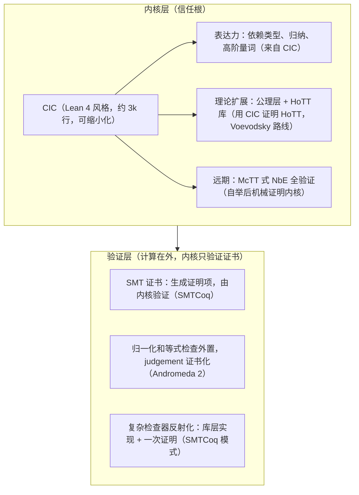

# 验证内核选型与融合架构（历史记录）

> 定位：受众 = 学术（兼维护者）；状态 = archived。
>
> **2026-10-24 Q18 更新：本文的 CIC 选型、CIC 信任根、Rocq/Lean 路线与 SMTCoq 证明项路线均已废止。最终信任根 = McTT；CIC 仅作为历史对照。当前规约设计见 `docs/maintainer/design/spec-design.md`。**
>
> 以下正文保留为选型历史，不再代表当前决策。

> 信任根（历史）= CIC 内核。表达力 = CIC + 公理（axiom，作为前提接受、不加证明的命题）+ HoTT 库。自动化 = 证书形态（计算在外、健全性在内）。
> 采用各体系的优点，不偏向单一体系：每个维度取最优，其他体系作为方法来源。

## 一、问题

规约系统（`docs/maintainer/design/spec-design.md`）需要 Coq 级别的表达力（依赖类型/归纳/高阶量词）。表达力由验证内核提供，内核是信任根：内核有 bug，所有证明都不可信。本文档记录内核选型论证与融合架构决策（2026-08-10）。

## 二、理论体系全谱系（选型时的候选）

| 体系 | 代表 | 表达力 | 内核规模 | 数学完备性 | 自动化生态 |
|---|---|---|---|---|---|
| CIC（归纳构造演算） | Rocq / Lean 4 | 依赖类型+归纳+高阶 | 中等（Rocq 7.8k 行 / Lean 3k 行） | 函数外延性/商类型要公理 | SMTCoq（Rocq）、hammer |
| MLTT（Martin-Löf） | Agda / McTT | 同 CIC 族（归纳族更精确） | 中等 | 同 CIC | 弱 |
| HoTT/Cubical | Cubical Agda、redtt | + 商类型/外延性定理可证 | 大（归一化复杂） | 理论最优 | 生态小 |
| HOL（简单类型论） | Isabelle/HOL、HOL Light | 无依赖类型（表达力上限） | 极小（HOL Light ~500 行） | 外延性天然 | sledgehammer 自动化领先 |
| LF/公理拼装 | Metamath | 靠公理 | 极小（~600 行） | 依赖公理集 |  |

选型结论：根据 Core 的约束（依赖类型表达力 + 自举路线 + SMT 证书架构）：

- 理论表达力最强的是 HoTT，工程实现最合适的是 CIC 系。
- HOL 系不使用（没有依赖类型）；MLTT 与 CIC 同族（CIC 的归纳类型更完整）；HoTT 的完备性用公理和库层补。
- CIC 系中 Lean 4 内核（~3k 行）是自举最友好的实现。

## 三、2025–2026 最新扫描（无全新竞争体系，全新的是方法）

| 工作 | 年份 | 贡献 | 对 Core 的意义 |
|---|---|---|---|
| McTT（Jang/Gaulin/Hu/Pientka, ICFP'25） | 2025 | 全验证的 MLTT 内核（含 NbE 归一化证明，OCaml 提取；除 lexer/pretty-printer 外全管线验证） | 内核全验证从目标变成工程实践，是自举路线终点的参考方法 |
| Andromeda 2（Bauer/Petković） | 2022+ | 证书内核形态：归一化/等式检查在内核外，内核只构造 judgement + 验证证书；用户可定义理论 | 与 SMT 证书架构同构，确认“计算在外、健全性在内”是当前前沿方向 |
| Definitional Proof Irrelevance（Felicissimo 等, LICS'26） | 2026 | CIC + 观察等式 + 严格命题（定义性证明无关），一致性与 canonicity 证明，Rocq 实现 | CIC 系仍在演进 |
| Lean4Less（Vaishnav, 2026） | 2026 | Lean 内核缩小化翻译（去掉 K 归约等便利定义性等式，Lean− 更小理论） | 实现 Lean 内核时可以采用缩小版，作为内核最小化的参考 |
| Lean 内核 bug 事件（Collatz/AI） | 2025 | AI 利用嵌套归纳类型的无规范内核 bug 产出假证明；外部检查器复制同一个 bug（代码即规范） | 自举内核必须有正式规范：先规范，后实现，或者用 Rocq 验证（MetaRocq 路径） |

扫描结论：没有出现推翻 CIC 的全新理论体系；新出现的是内核形态（证书化、验证化）和元方法（NbE 验证），这些方法可以纳入既有架构。

## 四、融合架构（决策，2026-08-10）

不偏向单一体系：每个维度取最优，其他体系降级为方法来源。

### 决策要点：三个维度分别取最优

| 维度 | 取谁的 | 为什么 |
|---|---|---|
| 信任根 | CIC 内核（最小）+ McTT 验证方法（远期机械证明） | 同时获得表达力和可验证性 |
| 表达力 | CIC + 公理 + HoTT 库（不换理论，挂载） | 数学完备性由库层提供，内核不增长 |
| 自动化 | 证书形态（SMTCoq + Andromeda 同构） | 计算在外、健全性在内，与自举和验证路线兼容 |

### HoTT 不换内核的依据：用 CIC 证明 HoTT

- HoTT/Coq 与 UniMath 的先例：标准 CIC 内核 + Univalence 公理（Voevodsky 模型证明一致）。
- 公理化 UA 不可计算（含 UA 消除的证明项归一化会 stuck），但日常规约验证不使用 UA，它只在数学库层需要，工程分层可以自然隔离。
- Lean 4 内核原生支持 quotient + proof irrelevance（Rocq 无），Lean 内核加 UA 公理接近更完整的 HoTT 基础。
- 结论：HoTT 是挂在 CIC 上的公理和库层，不是竞争体系。

## 五、信任根与自举路线

1. 初期：绑定成熟内核（候选：Rocq / Lean 4，开放决策）。
2. 自举：用 Core 写出 CIC 内核（Lean 4 风格，可缩小化），然后替换外部依赖（与 corec 自举同构）。
3. 验证（远期）：McTT 式 NbE 全验证，为自举内核提供机械正确性证明。
4. 规范先行（内核 bug 事件的教训）：自举内核先有正式规范，后实现，避免“代码即规范”；规范可以用 Rocq 验证（MetaRocq 路径）。

先例：Coq Coq Correct!（被证明正确的 Coq 内核）、Milawa（逐层自举：A 验证 B，B 验证 C）、McTT（全验证管线）、MetaRocq、lean4lean 和 agda-core（验证内核项目仍在进行）。

## 六、开放决策点（挂起，待外部贡献者参与）

| 决策点 | 状态 |
|---|---|
| 内核选择：Rocq vs Lean 4 | 待定。两者都是 CIC 类，规约语言、SMT 证书、翻译桥和自举路线不受影响。需要维护者与外部贡献者共同决定 |
| 整数语义（数学整数 vs 机器整数，见 spec-design 第 9.4 节） | 倾向“默认数学整数 + 显式位宽标注”，与内核选择一并决定 |
| 自举内核的规范语言 | 待定，随自举进度决定（候选：Core 规约语言自身或 Rocq） |
| 证明项逃逸的最终形态 | 待定，随内核选择与自举进度决定 |

## 参考

- SMTCoq（Ekici/Mebsout/…, CAV'17）：SMT 证书转换为 Coq 证明项，求解器不可信，健全性只在内核。
- McTT（Jang/Gaulin/Hu/Pientka, ICFP'25）：全验证 MLTT 内核，NbE 归一化证明，OCaml 提取。
- Andromeda 2（Bauer/Petković Komel, LMCS'22）：证书内核形态，归一化在内核外，judgement 证书化，用户可定义理论。
- Definitional Proof Irrelevance Made Accessible（Felicissimo 等, LICS'26）：CIC + 观察等式 + 严格命题。
- Lean4Less（Vaishnav, 2026）：Lean 内核缩小化翻译（extensional-to-intensional）。
- Coq Coq Correct!（Sozeau 等, 2020）：被 Coq 证明正确的 Coq 内核。
- Milawa / Self-certification（Strub 等, POPL'12）：逐层自举，信任降到最小可审计内核。
- MetaRocq / lean4lean / agda-core：验证内核进行中项目（INRIA 2026 综述）。
- HoTT/Coq、UniMath：CIC + Univalence 公理形式化 HoTT 的先例。
