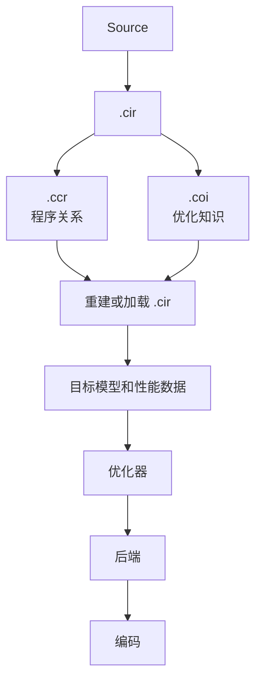

# .coi 优化知识附属格式

## 概述

`.coi` 是可选、非权威的优化知识附属文件。它保存可复用的通用优化知识和目标特定优化知识。`.ccr` 保持为目标无关的程序关系表示。

一句话定义：

> `.coi` 是可选的、非权威的附属文件，保存可复用的通用和目标特定优化知识，同时让 `.ccr` 继续作为目标无关的程序关系表示。

设计状态：定稿，尚未实现。`g_opt_meta` 的现状核对、格式展开、检查细节和待定事项见实现记录 `docs/superpowers/implementation/2026-09-23-coi-revision-audit.md`。

## 核心规则

删除全部 `.coi` 文件，程序仍然正确、仍然可读。删除只允许增加编译成本或降低优化质量。

这条规则可以机械检查，必须两向：

- 正向：删除全部 `.coi`，编译返回 0，ELF 和 `.ccr` 逐字节相同。
- 反向：至少有一条记录在装载后使某项可测工作量下降。否则 `.coi` 可能根本没有被读取，正向检查会形式通过。

只有正向，检查对“`.coi` 影响语义”总是通过；只有反向，检查对“`.coi` 没被读取”总是通过。

## 管线位置



依赖方向是 `.coi` 依赖 `.ccr` 和 `.cir`。`.ccr` 不依赖必需的 `.coi`。`.ccr` 的加载和发射不读取 `.coi` 是否存在。

## 边界

### 属于 `.ccr`

- 程序关系：值流、生成方法、图活性。
- 类型和接口。
- 条目、版本、存在区间和区域。
- 字符串和符号。
- 目标无关的 relation 元数据。

`.ccr` 不可丢。丢弃它会让程序失去意义。

### 属于 `.coi`

- 寄存器分配决策。
- 栈共享决策和 CSE 结果。
- 通用优化知识，例如归约识别、仿射访问、融合候选、依赖摘要、并行候选、代数优化机会、模式识别结果和规范化子图。
- 目标特定优化知识，例如指令选择候选、分块偏好、布局偏好、目标分解、调度候选、向量宽度、加速器映射和代价估计。
- 代价记录。
- 索引等加速结构。

`.coi` 可以丢弃，也可以从 `.cir`、`.ccr` 和分析过程重新生成。丢弃只会变慢。

### 两者都不属于

- 硬件能力描述：归 HIT 表、hw-map 或 CapabilityDomain。
- 硬件拓扑：归 Target Model 或执行映射。
- canonical target model：归 Target Model。
- 运行时机器状态：归 RuntimeState 或 profile 数据。
- 优化器过程历史：不写入文件。
- 机器码缓存。
- 规约和证明。
- 运行时部署数据库。

判断方法：丢弃它会不会让程序失去意义？会，属于 `.ccr`。不会，但会变慢，属于 `.coi`。两者都不是编译器该保存的，归第三处。

## 两个优化域

### 通用优化知识

通用知识包括分析摘要、归约识别、仿射访问、融合和拆分候选、规范优化形式、可复用依赖摘要、并行候选、代数优化机会、模式识别结果和规范化子图。

通用信息可以从 `.cir` 和 `.ccr` 重新推导。它存在的理由是复用和减少编译时间。通用信息不能引入权威程序表示中无法恢复的语义。

检查：清空通用段后重新计算，应得到逐字节相同的记录集。

### 目标特定优化知识

目标特定知识按 ISA、ISA 特性集、微架构、加速器家族、GPU 架构、NPU 代次、实现修订和编译器兼容级别绑定。

示例：

```text
x86-64-v4:    模式 P -> AVX-512 候选
zen5:         区域 R -> 首选调度形式
nvidia-smXXX: 子图 S -> tensor core 候选
target-NPU:   图 G -> 原生原语候选
```

目标特定记录仍然只是优化知识。后端和验证器必须独立确认合法性，然后才能使用。`.coi` 只能提名候选，不能决定采用。

## 设计不变量

1. `.ccr` 独立于 `.coi`。`.ccr` 的字段、段和加载检查不引用 `.coi`。
2. `.coi` 可以依赖 `.ccr` 和 `.cir` 的身份。每条记录至少有一个指向 `.ccr` 身份的字段。
3. `.coi` 永远可选。`{ccr}` 和 `{ccr, coi}` 都是合法输入，语义等价，产物逐字节相同。
4. `.coi` 不是语义权威。使用记录前，当前编译器必须能独立验证该变换保持语义。
5. 通用记录和目标特定记录可以共存。候选集是通用记录加上与目标兼容的目标记录。
6. 目标特定记录必须声明兼容条件。没有目标描述符的记录是格式非法。
7. 陈旧记录必须可以安全丢弃。失效是记录级局部的，不产生诊断，不改变产物。
8. 未知的可选记录种类必须可以跳过。未知 `kind` 和未知段跳过，不拒绝整个文件。
9. 优化候选仍然必须经过正常合法性检查。`.coi` 命中不能短路验证。
10. 硬件能力和模型信息本身不是 `.coi`。`.coi` 只引用能力名和维度，不定义它们。
11. 运行时机器状态不是 canonical `.coi`。当前热状态、时钟、空闲 VRAM、NUMA 放置、争用和可用设备数不写入 canonical 段。
12. 优化器过程历史不是可复用知识。搜索队列顺序、被拒候选历史、临时哈希表、分配器临时状态、瞬态 SSA 编号、求解器内部状态、临时 e-graph 节点和后端调试轨迹不进入记录。

不变量 3、4、9 共同保证 `.coi` 不改变语义。不变量 7、8 保证旧记录和未知记录不会破坏加载。不变量 10、11、12 保证 `.coi` 不成为硬件模型、运行时状态或过程日志的第二来源。

## 正确性模型

```text
use(O) 合法，仅当当前编译器能独立验证应用 O 保持所需程序语义。
```

四条失效映射：

```text
.coi 损坏     -> 丢弃或拒绝优化信息
.coi 缺席     -> 重新计算优化知识
.coi 不匹配   -> 使受影响的记录失效
.coi 陈旧     -> 忽略受影响的记录
```

`.coi` 不匹配不能改变程序语义。

记录是候选、缓存分析、可复用摘要或可复用匹配。记录不是必须信任的语义事实。

## 身份与失效

记录包含：

```text
record {
    id
    kind
    source_ref
    source_fingerprint
    validity
    payload
}
```

失效规则：

```text
指纹不匹配 -> 记录无效
```

身份使用双检查：

1. 结构指纹：对记录引用的 NOD、ENT、REG、TYPE 坐标及其内容做结构化摘要。
2. 生产者身份：生成记录的编译器或优化器的内容身份。

两个检查都匹配才命中。只靠自造指纹不够，因为指纹实现退化为 stub 时，旧记录会被不报错地命中。

身份取不到时，整个 `.coi` 不使用，等价于没有 `.coi`。不能写入“身份 0”的记录。

`source_ref` 的主定位点使用数值坐标，例如 NOD 行号、ENT id、REG 行号和 TYPE 项索引。字符串名只作诊断字段，不参与失效判定。原因是 `.ccr` 的字符串表会随无关的 intern 变化。

局部失效通过记录声明自己的引用区间实现。改一个区域只让覆盖该区间的记录失效。依赖全局结构的记录必须声明全局依赖，整片失效。

## 兼容性

需要区分四个版本：

| 版本 | 位置 | 不匹配时 |
|---|---|---|
| 格式版本 | 文件头 | 整个文件不使用 |
| 生产者版本 | 文件头 | 整个文件不使用，等价于没有 `.coi` |
| 记录版本 | 每条记录 | 跳过该记录 |
| 目标描述符版本 | 每个目标描述符 | 跳过该目标组 |

格式版本不匹配不能当作“空表”。但 `.coi` 本来可选，因此整档拒收等价于重算，不产生诊断。

`kind` 使用点分命名空间，例如 `generic.reduction` 和 `target.isel`。新增 kind 不提升格式版本。

## 目标匹配

目标条件描述架构、特性要求、特性排除、实现家族、最小和最大修订，以及后端 ABI 版本。

条件语言不新造。条件是“能力名和区间”的析取范式：

```text
predicate := clause ("|" clause)*
clause    := term ("&" term)*
term      := feature_name [relop bound]
relop     := >= | <= | == | !=
```

没有关系符表示存在性判断。特性排除用 `!=` 表达。实现家族和修订统一成“名字加区间”，不设三套语法。

部分匹配由析取范式自然给出。更具体的子句优先。能力名的词汇表不归 `.coi` 定义，来源是 HIT 表或 CapabilityDomain。

选择模型：

```text
通用知识 + 所有兼容的目标特定知识 -> 优化器候选集
```

目标未知时只使用通用知识。`.coi` 缺席时从 `.cir` 和 `.ccr` 重新发现。两种降级必须走同一条代码路径，避免两套语义。

## 代价信息

代价数据可以出现在目标特定记录里，但它是条件性的、非权威的。

来源包括静态目标模型、基准测量、profile、启发式估计和编译器估计。

```text
cost {
    metric
    value
    confidence
    source
    environment_signature
}
```

依赖运行时状态的代价信息应放在 runtime 或 profile 数据里，不进入 canonical `.coi`。当前热状态、当前时钟、空闲 VRAM、NUMA 放置、争用和可用设备数都不进入 canonical 段。

`static-model` 和 `compiler-estimate` 可以进入 canonical 段。`measured` 和 `profile` 只能进入条件段，并且必须带 `environment_signature`。消费方需要独立确认签名匹配，否则降级为启发式估计。

## 记录类

首批通用记录类：

```text
GENERIC_PATTERN
ANALYSIS_SUMMARY
REDUCTION_INFO
AFFINE_INFO
DEPENDENCE_SUMMARY
PARALLEL_CANDIDATE
FUSION_CANDIDATE
NORMAL_FORM
REWRITE_CANDIDATE
```

首批目标特定记录类：

```text
TARGET_PATTERN
ISEL_CANDIDATE
SCHEDULE_CANDIDATE
TILING_CANDIDATE
LAYOUT_CANDIDATE
VECTORIZATION_CANDIDATE
ACCELERATOR_MAPPING
TARGET_COST
```

这些名字是首批注册条目，不是固定枚举。`kind` 使用命名空间注册表。注册表命中时按对应 schema 解析；未命中时跳过。

## 容器

容器与 `.ccr` 同构，使用定长头、段表和段体：

```text
header:     magic u32 | format_version u32 | seg_count u32 | reserved u32
seg table:  seg_count × {tag u32, offset u32, size u32}
seg bodies
```

与 `.ccr` 有三处必须不同：

| 项 | `.ccr` | `.coi` |
|---|---|---|
| magic | `"CCR1"` | 不同值，防止串档 |
| 版本检查 | 严格等于当前版本 | 独立版本，不匹配时整档不用 |
| 未知段 | 拒绝 | 跳过 |

`.ccr` 的段承载语义，未知段意味着有语义没有读到，必须拒绝。`.coi` 的段承载优化信息，未知段可以跳过。

容器分节：

```text
COI Header
String/Namespace Table
Entity Reference Table
Generic Section
    Record[]
    Index[]
Target Section
    TargetDescriptor[]
    TargetRecordGroup[]
    Index[]
Integrity Section
    可选校验和
    可选分段哈希
```

物理分节是分发的要求。剥离目标段、替换某个目标组和合并多个 `.coi` 都是段级操作，不需要修改 `.ccr`。

## 索引

索引维度包括源实体、区域、关系指纹、优化种类、目标条件和模式签名。

索引是表示层的加速结构，不是优化语义，可以重建。删除索引段后，装载得到的候选集必须逐条相同，只允许工作量变化。

索引不参与失效判定。索引只回答“去哪里找”，记录是否有效由身份检查决定。

## 安全

`.coi` 分发时按不可信输入处理。

解析器必须校验长度、偏移、段边界、记录版本、引用有效性、目标描述符边界和内容格式。

伪造记录可以导致拒绝、回退或增加编译工作量。它不能导致接受非法变换、语义损坏或验证器绕过。

解析器使用线性单遍、无回溯、先验边界校验。内容是带长度的不透明字节，格式层不递归解析。内存占用上界是文件大小的常数倍。模糊测试覆盖随机字节、截断、长度溢出和越界偏移，结果必须是返回非零或安全跳过，不能崩溃。

## 分发、更新和合并

合法分发包：

```text
program.ccr
program.ccr + program.coi
program.ccr + program.coi + runtime/profile 数据
```

一个 `.coi` 可以包含多个目标特定记录。分发者可以剥离与部署无关的目标记录，不修改 `.ccr`。

更新操作包括重新生成全部 `.coi`、只重新生成通用段、增加新目标、替换一个目标段、丢弃陈旧记录和合并兼容的优化包。全部是段级或档级操作。

多个 `.coi` 是常态。装载器接收文件列表。合并结果是候选集，不是“胜者”。冲突的优化候选不是语义冲突，优化器分别评估。

合并排序键：

```text
validity > specificity > schema 新旧 > verified
```

排序不是过滤。有效性优先于特异性，兼容的更具体目标记录优先于通用记录。来源不同的同一记录保留为多个候选，需要另行规定候选集上界。

## 实现顺序

1. 身份和失效方案：数值坐标主定位点加双检查。
2. 容器框架和未知段、未知 kind 的跳过能力。
3. 物理分节：通用段、目标段、每个目标组。
4. 单条通用记录的端到端只读通道，先证明可选性和非权威性。
5. 目标条件、目标记录和候选集合并。
6. 失效检测的反向检查项。
7. 可测量收益、代价记录和索引。

第 4 步必须先证明不变量 3 和 4，再谈优化收益，避免“先有收益、后发现语义影响”的返工。

## 验收

1. 删除全部 `.coi`，返回 0，ELF 和 `.ccr` 的 sha256 相同。
2. 把全部 `.coi` 读点强制为未命中，产物仍逐字节相同。
3. 把 `.coi` 内容替换为固定种子的随机字节，产物与无 `.coi` 时相同，返回 0。
4. 同一区域同时挂通用记录和两个不同目标记录，候选集为 3 条。目标未知时候选集为 1 条。
5. 改动被引用结构的一个字节，该记录失效，产物等于无 `.coi` 状态；不改动时该记录必须命中。
6. 同一语料分别在有 `.coi` 和没有 `.coi` 时编译，分析或匹配计数下降，产物逐字节相同。`.coi` 全部失效时计数回到无 `.coi` 水平。

## 非目标

`.coi` 不是 `.cir` 或 `.ccr` 的替代品，不是规约格式、证明格式、调试数据库、运行时部署数据库、硬件能力描述、硬件拓扑格式、canonical target model、强制 PGO 容器、机器码缓存、优化器执行日志或权威变换历史。

不保存搜索队列顺序、被拒候选历史、临时哈希表、分配器临时状态、瞬态 SSA 编号、求解器内部状态、临时 e-graph 节点和后端调试轨迹。

## 未决问题

| # | 问题 | 当前倾向 |
|---|---|---|
| 1 | 是否复用 `.ccr` 的段表辅助函数 | 独立实现，避免版本节奏耦合 |
| 2 | 是否预留分段压缩标志位 | 预留但恒为 0 |
| 3 | 是否需要跨重编稳定的实体 ID | 不需要，使用 `.ccr` 文件序坐标 |
| 4 | 结构指纹的算法和确定性要求 | 需要实测 |
| 5 | 能力条件的词汇表真源 | 首批用 HIT 表，长期与 CapabilityDomain 收敛 |
| 6 | 同一 `(source_ref, kind)` 内容不同时保留几条 | 保留全部，另加上界 |
| 7 | 是否增加来源声明字段 | 增加，仅用于溯源 |
| 8 | `band` 和 `confidence` 是否并存 | 并存，需要确定优先级 |
| 9 | `g_opt_meta` 搬迁时机 | 需要维护者决定 |
| 10 | 栈共享和 CSE 键的处置 | 废弃或迁入 `.coi` 首批 kind |
| 11 | `.coi` 的默认发现路径 | 默认同名，可追加多源 |
| 12 | `.cir` 是否进入分发包 | 当前读法是不入，需要确认 |

## 关联

- 现状核对和修订记录：`docs/superpowers/implementation/2026-09-23-coi-revision-audit.md`
- `.ccr` 设计：`docs/maintainer/design/ccr-v8-open-relational-lattice.md`
- 执行映射：`docs/maintainer/design/execution-mapping-design.md`
- 存在格：`docs/maintainer/design/materialization-space.md`
- 现行 `.ccr` 格式：`docs/ir-schema/coreir-schema.md`
