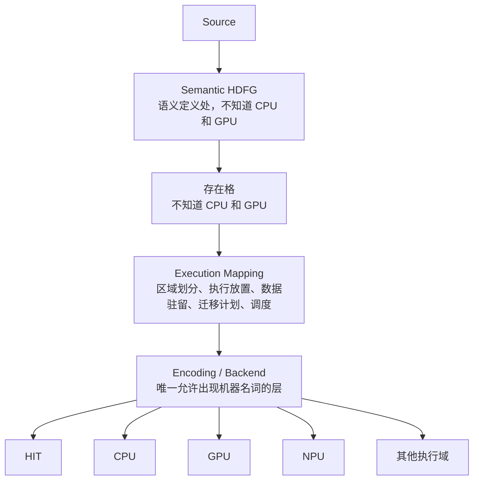
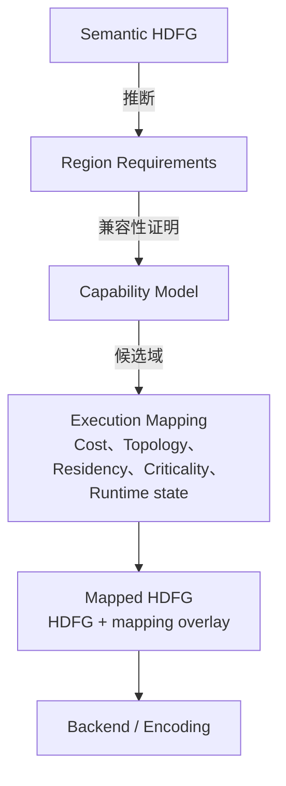

# 执行映射设计

## 概述

Core 程序只描述计算。执行映射决定计算在哪个执行域发生，跨域的数据如何物化和迁移。任何没有指定或无法优化的计算，始终存在通用下降路径。

设计状态：定稿，尚未实现。原始 30 节展开、字段级核对、冲突登记和未核实清单见 `docs/superpowers/implementation/2026-09-20-execution-mapping-audit.md`。

## 架构位置



三条禁令：

- HDFG 不知道 CPU 和 GPU。
- 存在格不知道 CPU 和 GPU。
- HIT 不需要为了异构计算修改语义。

HIT 位于发射层，在放置下游。放置信息不进 HIT 表，这是既有规则。

五层细化：



Mapped HDFG 不是第二份语义 IR。原 HDFG 仍是语义基准，mapping overlay 可以整体摘除。

## 用户接口

放置只有三种状态：

```core
flow compute { ... }                       // automatic
@preferredDomain(gpu) flow compute { ... } // soft constraint
@executionDomain(gpu) flow compute { ... } // hard constraint
```

| 源码形态 | 语义 | 无法满足时 |
|---|---|---|
| 无注解 | `placement = automatic` | 必须存在合法解 |
| `@preferredDomain(X)` | 软约束，进入 cost function 的偏置项 | 回退到 automatic 或通用路径 |
| `@executionDomain(X)` | 硬约束，属于部署约束，不是程序语义 | 编译或部署错误，不能回退 |

作用范围包括 `fn`、`flow`、`loop`、`for` 和显式区域。

```core
fn pipeline(...):
    prepare()

    @executionDomain(gpu)
    flow compute:
        ...

    finish()
```

`prepare` 和 `finish` 留在原域，`compute` 放到 GPU。不要求整个函数进入同一个域。

嵌套规则：

1. 离当前执行区域最近的注解生效。
2. 同一近度下，硬约束优先于软约束。
3. 父区域和子区域可以跨域，数据迁移自动产生。

`gpu`、`cpu`、`npu` 不是语言内建名称。Core 只认识逻辑域名，域名来自部署配置：

```toml
[executionDomain.cpu]
backend = "hit"
device  = "cpu0"

[executionDomain.gpu]
backend = "gpu"
device  = "0"
```

换机器只改配置，源码不变。逻辑名不应把机器形状带进程序语义。

## 数据结构

### ExecutionDomain

```text
ExecutionDomain {
    id                        逻辑名，部署配置键
    backend                   后端标识
    attachedMemoryDomains[]   关联的内存域
    dispatchModel
    profile                   性能画像
    capabilities              能力域
    limits                    数值上限
}
```

`backend` 自己回答 `canLower(region)`。mapper 不直接判断 GPU 或 CPU。

### MemoryDomain

MemoryDomain 表示可寻址的存储域，例如 DDR、VRAM 和统一内存。执行域和内存域不能合并。

### TopologyLink

TopologyLink 表示执行域和内存域之间的连接，包括带宽、延迟和方向。placement 和迁移成本使用这些数据。

### ExecutionRegion

放置的基本单位是执行区域，不是单个 DFNode。执行区域来自 HDFG region、`flow`、`loop` 和函数。编译器可以进一步做区域合并或拆分，得到执行簇。

```text
DFNodes -> semantic regions -> execution clusters -> placement
```

按区域放置可以避免逐节点迁移导致的调度和传输成本。

### Residency

Residency 表示某个条目当前驻留在哪个内存域。它影响迁移成本，也影响运行期是否值得把计算放到另一个域。

### Materialization

物化表示条目在某个域中的一份存在。字段和判定规则以 `docs/maintainer/design/materialization-space.md` 为准。执行映射侧只使用这些字段，不重新定义。

## 能力格

执行区域先推断需求：

```text
HDFG Region
  推断
RequirementSet

ExecutionDomain
  声明
CapabilitySet

合法映射条件：RequirementSet ⪯ CapabilitySet
```

只有满足条件的域才进入 cost model。

能力维度有十类：

| 维度 | 内容 |
|---|---|
| Computation | 标量、向量、矩阵、特殊运算 |
| Control | 分支、循环、间接调用、递归、动态派发、发散控制 |
| Parallelism | 任务、数据、向量、流水线、嵌套、最大并发 |
| Storage | 私有、组共享、域共享、持久、一致性 |
| Addressing | 直接、索引、间接、随机、gather、scatter、类指针 |
| Synchronization | 事件、屏障、原子操作、内存序 |
| Communication | 消息、流、点对点传输、异步传输、直接远程访问 |
| Effects | 外部调用、系统调用、MMIO、设备 IO、文件 IO、网络 IO、定时器 |
| Dynamism | 动态分配、动态图、动态生成、动态形状、动态派发 |
| Guarantees | 确定性、精确异常、有序副作用、浮点语义、内存一致性 |

`divergentControl` 表示执行域能正确表示不同控制流，不表示它一定快。`Storage` 和 `Addressing` 分开：前者描述可以有什么存储，后者描述计算怎么访问数据。`Guarantees` 是合法性条件，不是性能条件。规约要求严格 IEEE 浮点时，只有 relaxed 浮点的加速器再快也不能进入候选集。

能力格需要先做闭包。偏序示例：

```text
FP16 ⪯ FP16 + FP32 ⪯ FP16 + FP32 + FP64
indexed ⪯ gatherScatter ⪯ generalIndirect
```

合法映射是 `RequirementSet ⪯ CapabilitySet`。不按设备类别分类，不写 `Cap { gpu = true }`，而是写具体的计算、寻址和控制能力。

## 放置模型

### 成本

```text
Cost(R, D) = C_compute + C_dispatch + C_input + C_sync + C_policy
```

| 项 | 含义 |
|---|---|
| `C_compute` | 区域在目标域的执行时间 |
| `C_dispatch` | 启动和提交成本 |
| `C_input` | 输入物化和传输成本 |
| `C_sync` | 跨域同步成本 |
| `C_policy` | 部署策略和 `preferredDomain` 的惩罚 |

`preferredDomain` 只改变偏好惩罚，不是绝对规则。GPU 成本极高或传输很慢时，仍然可以选择 CPU。

目标函数是 makespan：

```text
min Makespan(G, P)
约束：RequirementSet(R) ⪯ CapabilitySet(P(R))
再考虑执行、物化、同步、调度成本和重叠
```

比逐个区域求成本之和更合理。单独看一个区域可能选择 GPU，但前后传输成本会让整体更慢。

第一版算法使用 Residency-Aware HEFT，并加入 PEFT 风格的未来成本估计：

1. 得到执行簇的 DAG。
2. 估计每个簇在每个域上的执行成本。
3. 估计每条跨簇边的传输成本。
4. 按关键路径排序。
5. 逐个选择最早完成的域。
6. 应用硬约束和软约束。

关键性属于运行期状态。不在关键路径上的区域放到较慢的域可能没有问题，把快域留给关键区域反而更好。

### 静态和动态

编译时知道 HDFG、依赖、区域、操作、估算数据量、静态规模和 state edge。编译时不知道 GPU 当前负载、输入实际大小、实际驻留、温度和功耗限制。

```text
编译时：推断需求、枚举合法域、生成变体、估算成本、初始调度
运行期：实际大小、当前驻留、当前负载、动态关键性、最终放置
```

静态部署时，运行期 mapper 被删除。同一模型支持桌面动态、服务器动态、嵌入静态和裸机静态。

### 变体数量

一个区域可以有多个 lowering：

```text
Region R
Variant: HIT 通用路径 / CPU / GPU
```

第一版规则：

- HIT 通用路径永远存在。
- 硬约束只生成指定域，可选生成 HIT 验证参考。
- 软约束和自动模式只生成前 K 个候选，例如 K = 2。

不能为每个区域、每个域、每种优化都生成变体。

### 后端接口

```text
canLower(region, domain)
estimateCost(region, domain)
emitVariant(region, domain)
```

mapper 不写 `if GPU` 或 `if CPU`。新增硬件只需要实现后端。

### 部署约束

`@executionDomain` 是部署约束，不是程序语义。同一个区域放到 HIT、CPU 或 GPU，语义相同，只是执行映射不同。

部署无法满足硬约束时，是映射失败，不是类型错误。诊断应单独归类，例如 `EMAP` 错误码段。

## 不变量

### 1. 放置元数据不改变 HDFG 的语义身份

删除全部放置注解后，HDFG 的序列化结果必须与没有注解时相同。放置注解只进入 overlay，不进入值流、state edge 或区域结构。

检查需要正反两条：

- 正：有注解和没有注解的 `.cir`，摘除放置段后其余部分逐字节相同。
- 反：放置段非空，dump 输出确实显示域约束。否则“什么都不做”也会通过。

### 2. 执行域不等于内存域

执行域和内存域不能合并。存在多个执行域共享一个内存域，也存在一个执行域连接多个内存域。合并会丢失“统一内存”和“两个 CPU 共享一个 DDR”这类结构。

检查：部署配置构造上述两种情形，断言执行域索引和驻留键空间是两个独立 ID 空间。把两张表合成一张时，检查必须失败。

### 3. 能力不等于性能

合法性只读能力域：

```text
legal(R, D) = RequirementSet(R) ⪯ closure(CapabilitySet(D))
```

收益评分只读性能、拓扑、驻留、关键性和运行期状态。先过滤合法性，再评分：

```text
candidates(R) = { D : legal(R, D) }
placement(R)  = argmax score(R, D)
```

能力缺失的域不能因为成本低而进入候选集。性能数据缺失的域仍然合法，只是退化到默认形态。两者不能放进同一个加权和。

### 4. 物化必须绑定条目和版本

每个物化携带精确的 `(identity, version)`。消费者读取时必须指定版本，版本来自图，不来自运行期比较。

禁止：

- 全局的“哪份更新”比较。
- `latest(entry)` 查询。
- `valid` 位。
- 按值相等判断副本可复用。
- 对不可复制的条目生成第二份物化。

不可重算条目的移除必须走状态转移分支，不能按可重算处理。

### 5. 硬约束不能降级

`@executionDomain(X)` 且 `X` 不可用时，必须映射失败：`rc=1`，零产物。不能回退到 automatic，不能回退到通用路径，不能返回 `rc=0`。

`@preferredDomain(X)` 在同样配置下应该回退，返回 `rc=0`。这条反向断言防止实现把所有约束都当编译错误。

### 6. 静态部署不产生第二条路径

`mapping = "static"` 时，区域到域在编译期确定，产物不含动态 mapper。判定结果和动态模式一致，使用同一套能力和约束规则。

检查：同一份源码分别用静态和动态模式构建。静态产物没有 mapper 符号和运行期域查询；动态产物确实包含 mapper；两种模式都不违反不变量 1。

### 7. 未指定时恒存在合法映射

没有注解的自动区域必须至少有一个合法域。这是通用下降路径的形式化。

检查：对全部语料断言自动区域的候选集非空。再构造一个候选集为空的畸形配置，断言它是编译错误，而不是被当作通过。

### 8. 移除必须满足可恢复或状态转移

```text
Evictable(x) <=> Recoverable(x) 或 PreserveRequiredState(x)
```

不可恢复且没有转移状态时，移除非法，不是“昂贵”。这条与物化层规则一致，执行映射侧只提供检查视角。

### 9. 格层不承担策略

格层只回答四个判定问题：合法性、共存、同一 Entry 和版本、转换是否保持语义。何时移除、放寄存器还是 RAM、是否保留驻留、LRU、write-back、prefetch，全部属于 mapper。

清空全部策略配置后，格层判定结果必须逐条不变。格层不能出现 `preferred`、`hot`、`recently used` 这类策略条件。

## 表示

放置元数据不进入 `.ccr`。`.ccr` 是语义 IR 的实现方式，放置按定义不能改变语义身份。把放置放进 `.ccr` 与不变量 1 相抵。

可选方案：

| 方案 | 评价 |
|---|---|
| 独立 MAP 段 | 检查强度高，但要在语义实现方式里放非语义物 |
| 附着在 REG 记录 | REG 记录已满，改布局同样要提升版本，检查强度更弱 |
| 只进 `.cir` 快照或独立侧表 | 与不变量 1 同向；`corearch` 读不到时，另立非语义侧表示 |

当前倾向只进 `.cir` 快照或独立侧表。如果后续 `corearch` 需要读取放置，应新增部署配置、mapper 自有表或独立 side file，不回到 `.ccr` 段。

## 阶段

| 阶段 | 内容 |
|---|---|
| M0 | 规范：执行域、内存域、拓扑、驻留、三种放置状态 |
| M1 | 语法：两种注解，限制作用位置，解析到侧表 |
| M2 | IR metadata：放置注解和区域映射元数据，保持 HDFG 语义身份不变 |
| M3 | 逻辑域配置：部署配置定义执行域、别名、后端和设备 |
| M4 | 静态放置：先做 CPU 到 CPU 的同构和假异构，不涉及 GPU |
| M5 | 内存拓扑：内存域、互连延迟和带宽、条目驻留、物化计划 |
| M6 | 成本模型：执行、调度、传输、同步和偏好惩罚，HEFT 风格调度 |
| M7 | 变体设施：HIT 基准变体、多后端变体、候选裁剪 |
| M8 | 最小 GPU 后端：for、数组和算术子集，自动生成传输 |
| M9 | 运行期 mapper：实际规模、驻留、设备负载和动态选择 |
| M10 | 优化：区域合并、传输重叠、异步物化、驻留保留、重复执行画像 |
| M11 | 验证：变体观测等价，物化保持条目身份，放置不改变 state edge 语义 |

每个阶段的验收条件以实现计划为准。

## 不包含

- 不做 CUDA 风格 kernel 语法。
- 不做 `gpu fn` 或 `cpu fn`。
- 不做显式 memcpy。
- 不做 GPU 指针类型。
- 不做 host 和 device 两套语言。
- 不做用户级 capability tag 全集。
- 不做逐 DFNode 动态迁移。
- 不做全局最优 ILP 调度器。
- 不做机器学习调度器。
- 不做自动 profiling 数据库。
- 不做分布式执行。
- 不做多 GPU 复杂复制策略。

## 未决问题

| # | 问题 | 影响 |
|---|---|---|
| 1 | `flow` 块语法尚不存在，函数体内嵌套 `flow` 当前被拒绝 | M1 需要语法变更 |
| 2 | 逻辑域名与机器名词同形，例如 `gpu`、`cpu` | 是否允许，需要维护者决定 |
| 3 | 放置元数据的最终表示：`.cir` 快照、独立侧表还是 `.ccr` 段 | 格式和版本 |
| 4 | 执行域与内存域的拓扑数据由谁提供 | 部署配置和 Target Model |
| 5 | 静态部署下的诊断码和豁免表如何登记 | 错误码体系 |
| 6 | 变体的 K 值和成本模型参数 | 性能与编译时间 |

## 关联

- 修订记录和冲突登记：`docs/superpowers/implementation/2026-09-20-execution-mapping-audit.md`
- 存在格：`docs/maintainer/design/materialization-space.md`
- 执行模型：`docs/maintainer/design/execution-model.md`
- 存储语义：`docs/academic/cache-semantics.md`
- IR schema：`docs/ir-schema/coreir-schema.md`
- 优化知识：`docs/maintainer/design/coi-optimization-knowledge-sidecar.md`
