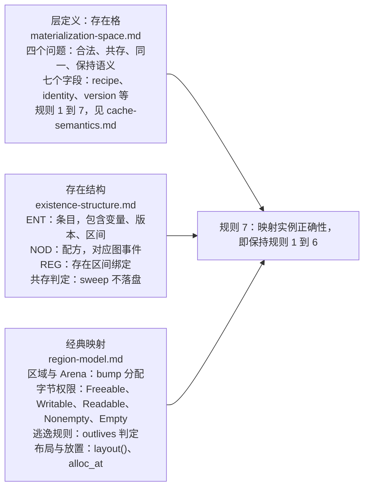

# 存储语义总览：存在格、存在结构、经典映射

> 定位：受众 = 维护者/贡献者；状态 = active。
> 本文件是存储语义三层结构的总览。层定义见 materialization-space.md（存在格，Materialization Space），规则来源见 cache-semantics.md，IR 表示见 existence-structure.md，经典映射见 region-model.md。
> 本文属于三层映射结构（图、格、编码）中的格层。术语以 docs/glossary.md 为准。
> 决定（2026-09-20，ADR-0021）：格层本体是存在格；缓存是格层的一类映射实例，不是格层的定义。

---

## 一、文档范围

| 文档 | 内容 | 读者 |
|---|---|---|
| [materialization-space.md](materialization-space.md) | 层定义：存在格（Materialization Space）。内容包括格层回答的四个问题、`Semantic Entry -> Materialization`、七个字段（recipe、identity、version、authority、location、persistence、replicability）、归类表和不变量改写 | 适用于所有内存讨论；验证器实现者 |
| [cache-semantics.md](../../academic/cache-semantics.md) | 规则 1 到 7（权威规则）、细读和范式映射表推论。缓存映射是该层最直接的一类实例，不是层本体 | 验证器实现者 |
| [existence-structure.md](existence-structure.md) | v6 存在结构：ENT、NOD、REG 如何表示规则（语义视角） | ccr_io、分配器、验证器实现者 |
| [region-model.md](region-model.md) | 经典映射：以图为依据的区域、Arena、字节权限和逃逸规则 | 内存管理实现者 |
| 本文件 | 三层关系、文档索引和关联 | 所有读者 |

## 二、三层结构总览

> 层与实例的区别：图中层定义一列是存在格本体。缓存语义是该层最直接的一类映射实例，包含方法、驱逐不变量和再生等价。层不等同于缓存语义。边界输入、MMIO 和线性资源同属该层，但不满足缓存假设，见 materialization-space.md 第 3 节。

## 三、术语定位

“内存”在仓库中有三层含义，见下表（详见 glossary）：

| 术语 | 含义 | 文档 |
|---|---|---|
| 物理内存 | 硬件（DRAM、寄存器、量子存储） | 无（硬件层） |
| 语义存储 | 存在格（范式无关本体），物化、方法、共存、驱逐、再生 | materialization-space.md |
| 缓存语义 | 上述本体最直接的一类映射实例（recipe 为 yes、replicable 为 yes、evictable 为 yes），不是本体的名字 | cache-semantics.md |
| 存在结构 | 本体在 IR 中的编码，ENT、NOD、REG | existence-structure.md |
| 映射 | 字节寻址、区域、Arena | region-model.md |
| 格 | 三层结构的第二层，即中间存在空间（本组文档整体）；“格（Lattice）代数”是映射参数，见 archive/memory-model-capability-lattice.md 第 4.4 节 | 本组 |

## 四、相关文档

- 寄存器分配是缓存语义的映射实例，四条判定见 docs/maintainer/design/regalloc-cache-mapping.md。
- 指针模型见 docs/maintainer/design/pointer-model.md，其中包含 provenance/region/byte permission/bounds 四个 pass。
- 控制流 region 与内存区域不同，见 execution-model.md 第 2 节和 existence-structure.md 的 REG。
- 术语见 docs/glossary.md 第 2 节（三层映射）和第 4 节（存在格与缓存映射术语）。
- 归档讨论见 docs/archive/memory-model-capability-lattice.md（v1 到 v4 备忘）。
