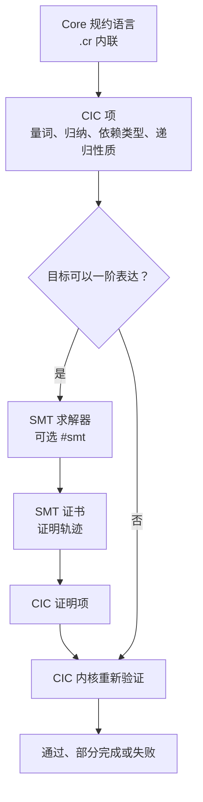

# Core 规约系统设计

规约是图上的约束。表达力来自 CIC（归纳构造演算）。自动化由 SMT 求解器生成证书，证书再由 CIC 内核验证。

设计状态：设计定稿，尚未实现。实现进度以 `TODO.md` 和 `docs/superpowers/plans/` 为准。验证器架构和信任根的完整论证见 `docs/academic/verifier-kernel.md`。

## 基本思路

Core 的语义中间表示是 HDFG，文件格式为 `.cir`。图包含程序的全部语义。规约不是对代码的另一套描述，而是图上的约束标注。

```text
# 正常编译，无规约
corec build file.cr         -> .cir + .ccr

# 编译并生成规约约束
corec build file.cr -s      -> .cir + .ccr + file.csr

验证 = 证明图的所有可达状态满足图上的约束。
```

## 架构

规约语言使用 Core 语法，编译为 CIC 项。验证走两条通道：



健全性的唯一来源是 CIC 内核。SMT 是证明搜索器，可以依赖启发式，甚至可能不健全。SMT 的输出必须经过内核验证才会被接受。证书校验失败就拒绝，不会引入不健全的结论。这是 SMTCoq 模式，见 CAV 2017。

### 表达力边界

CIC 提供 Coq 级别的表达力：

| 能力 | CIC 承担 | 用户需要做什么 |
|---|---|---|
| 全称量词和存在量词（无限域） | `forall` 和 `exists` 是语言一等构造 | 不需要额外工作，量词是规约语法 |
| 归纳类型和归纳原理 | 枚举、结构体、归纳类型、归纳原理都在内核 | 不需要额外工作 |
| 递归函数和终止性 | 递归定义加 `loop variant` 标注 | 写变体标注。EBNF 尚未定义，待实现 |
| 高阶量词（`forall f: int -> int`） | 函数空间原生支持量化 | 不需要额外工作，使用规约层函数类型 |
| 依赖类型（`Vec n`） | 内核支持，但 Core 不需要 | 由图验证替代：边界安全由图保证，长度性质由条件表达式表达 |
| 引理和定理复用 | 证明项可以组合 | 使用用户入口，见“约束验证与用户入口”一节 |

Core 不需要依赖类型。Coq 用 `Vec n` 在类型层面保证索引不越界和长度匹配。Core 的索引越界由指针模型的图验证保证，已经实现；长度性质由条件表达式表达，例如 `#ensure(result.len() == |a|)`。安全性由图保证，性质由条件表达式表达。

## 使用层次

规约用 Core 语言书写，不需要写数理逻辑公式。规约分三层，使用同一语言和同一 IR 格式：

| 层次 | 写法 | 负责方 | 例子 |
|---|---|---|---|
| 编译器自动推导 | 不需要手写，`.csr` 自动附带 | 编译器，通过图结构分析 | `#pure`、`#terminating` |
| 简单范围 | 一行 `#check` 或 `#ensure` | 用户写，编译器验证 | `#ensure(result > 0)` |
| 检查函数 | 用 Core 写一个纯函数 | 用户写，编译器验证 | `spec fn ... -> bool { ... }` |

三层最终都编译为 `.cir` 的规约 DFNode（条件表达式）和 `.csr` 的 TagNode（约束元数据）。验证工具看到的格式相同。

## 文件格式

独立规约源码格式 `.corespec` 已经废弃，见 ADR-0001。规约源写在 `.cr` 文件内，使用 `#check` 和 `#ensure` 标注。`.csp` 段落只保留为设计历史，不再作为输入格式。`.csr` 是约束二进制序列化，图标注机制不受影响。

### `.cr`：实现源码和内联规约

```core
// 简单范围
fn divide(a: int, b: int) -> int
#check(b != 0)
#ensure(result != None):
    if b == 0:
        return None
    return Some(a / b)

// 引用外部检查函数
fn sort(a: [int]) -> [int]
#ensure(auto::sort_check(a, result)):
    // 冒泡排序实现
```

### `.csr`：规约约束的二进制序列化

格式见 `docs/ir-schema/corespecir-schema.md`。文件结构：

```text
.csr 文件头 -> TagNode 数组 -> 符号引用表 -> 函数约束映射 -> 字符串表
```

每条 `#check`、`#ensure`、`#invariant` 和每个 `spec fn` 的函数体，都编译为 `.cir` 的规约 DFNode 和 `.csr` 的 TagNode。TagNode 记录约束类型、验证状态和行列号，通过 `target_node` 指向对应的 DFNode，通过 `condition_node` 指向条件表达式。

## 编译器自动推导

编译器从 `.cir` 图结构自动推导性质，写入 `.csr`，不需要用户书写。

| 标签 | 推导条件 |
|---|---|
| `#pure` | 没有 STORE 到外部变量，没有 CALL 到非纯函数 |
| `#deterministic` | 纯函数，并且没有随机或外部依赖 |
| `#terminating` | 所有循环都有可识别的变体 |
| `#no_alloc` | 没有 ALLOC、ALLOC_ARRAY、ALLOC_STRUCT 或 ALLOC_AT 节点 |
| `#no_throw` | 没有异常路径 |
| `#safe_index` | 所有索引访问都在边界内 |
| `#len_preserved` | 集合长度不变，没有插入或删除 |
| `#atomic` | 配对操作之间没有并发观测点 |

编译器还能识别常见图模式，生成检查函数框架。用户可以选择接受、忽略或手写更精确的替代：

```core
fn sort(a: [int]) -> [int]
// 编译器识别：只有比较和交换，没有插入或删除，生成 #len_preserved
// 有比较、分支和交换结构，生成 auto::sorted
// 纯函数，生成 #pure

fn transfer(from: &mut Account, to: &mut Account, amt: int)
// 编译器识别：from.balance 和 to.balance 有配对的加减
// 加减之间没有 yield 或 recv，生成 #atomic
```

用户可以对自动生成的约束做三件事：

- `#use auto::sorted`：接受。
- `#ignore auto::sorted`：跳过，编译器不再生成。
- `#check(result.len() == |a|)`：手写更精确的替代。

模式库可以扩展。社区可以贡献新的图模式和标签映射。

## 标签语法

标签使用 `#` 前缀，与 `@`（外部项目引用）区分。

```core
fn foo() -> int
#pure
#check(x > 0)

#tag sorted =:
    forall i: 0 <= i < result.len() - 1 -> result[i] <= result[i+1]
```

`#` 标记的内容不影响运行时语义。它不占用 `@`，`@` 保留给 `import @project`。

## 检查函数

检查函数是用 Core 写的纯函数，返回 `bool`。它们编译为 `.cir` 图，与实现函数的图并列，供验证器使用。

```core
spec fn 函数签名 -> bool
    #pure  // 编译器自动标注
{
    // 纯 Core 代码，可以有变量、循环和分支
    // 不能有 IO、unsafe 或外部调用
    return true_or_false;
}
```

检查函数和普通函数的区别：

| | 普通函数 | 检查函数 |
|---|---|---|
| 编译 | 生成代码 | 只生成 `.cir` 和 `.csr`，不生成机器码 |
| 副作用 | 可以有 | 必须纯 |
| 验证角色 | 被验证的对象 | 验证的标准 |
| 调用规则 | 可以在运行时代码中调用 | 不能在运行时代码中调用 |

习惯写公式的用户可以使用语法糖：

```core
// 检查函数写法
spec fn all_nonneg(arr: [int]) -> bool {
    for x in arr:
        if x < 0 { return false; }
    return true;
}

// 等价公式写法，编译器展开为检查函数
spec fn all_nonneg(arr: [int]) -> bool
    = forall x in arr: x >= 0;
```

## 量词

`forall x: int => P(x)` 必须是规约语言的一等构造，不能翻译成 `for` 循环，因为 `int` 的定义域无限，无法用遍历表达。`for` 循环只是有限域的语法糖，例如 `forall x in arr`。

```core
forall (x: int) => x >= 0
exists (i: int) => a[i] == target
```

量词语法尚未进入 `grammar/core.ebnf`，属于待实现语法。`grammar/corespec.ebnf` 已经退役，见 ADR-0001。

## 翻译层

### 问题

`spec fn` 用 Core 书写，是命令式代码：变量重复赋值、循环、数组、`return`。CIC 是纯函数式逻辑：lambda 演算、递归定义、归纳类型，没有赋值和循环。翻译层把命令式代码确定性地转换为函数式项，不丢失语义，也不增加语义。

`spec fn` 是纯的，没有副作用、IO、`unsafe` 或外部调用。纯命令式程序到函数式程序的翻译是经典确定性问题。

### 结构翻译

| Core 构造 | CIC 翻译 | 例子 |
|---|---|---|
| `x := expr` 或单次赋值 | `let x = expr in ...` | `total := 0` 变为 `let total = 0 in ...` |
| 重复赋值 `x = expr` | SSA 化，递归参数传递 | `x = x + 1` 变为递归调用参数 `f(x+1)` |
| `return expr` | 直接表达式化 | 函数体就是表达式 |
| `if` 和 `else` | 条件表达式 | `if b { A } else { B }` 变为 `if b then A else B` |
| `for x in arr` | fold 或递归遍历 | 对列表递归 |
| `for i in 0..n` | 有界递归，参数递减 | 变体是 `n - i` |
| `loop` 加 `break` | 尾递归，需要变体 | 变体标注待实现 |
| 数组 `a[i]` 读写 | 归纳列表索引或数组理论 select-store | 或使用带长度约束的结构 |
| 结构体和枚举 | 归纳类型构造子和 match | `Point{x, y}` 变为 `mk_point x y` |
| 递归调用 | CIC 递归定义，良基递归 | `fact(n) = n * fact(n-1)` |

核心模式是循环即递归：

```text
for i in 0..n: acc += a[i]
    =>
f(acc, i) = if i >= n then acc
            else f(acc + a[i], i + 1)     // 变体是 n - i，递减保证终止
```

### 终止性

CIC 只接受良基递归，递归参数必须严格递减。非终止的递归在 CIC 里无法定义。因此：

- 每个循环和递归翻译都必须携带变体，即递减度量。变体语法尚未定义，待实现。
- 编译器优先自动推导，使用 `#terminating` 图模式。推导不出的要求用户标注。
- 没有变体的循环，翻译失败，报编译错误；或者降级为未解释函数，由用户确认语义。

### 整数语义

Core 的 `int` 是无上限数学整数。2026-08-23 起，实现使用 i64 快路径，溢出时自动升级为堆上 BigInt，永不溢出。CIC 的整数 `Z` 也是无界的，翻译层在 `int` 上没有分歧。

位宽语义只出现在其他场合，例如 `dex` 定点内部表示和显式位宽标注：

| 选项 | 语义 | 代价 |
|---|---|---|
| 数学整数（默认） | 规约性质在无界整数上证明 | 简单。但 `#ensure(x + y > x)` 在数学域成立，机器域可能因溢出失败 |
| 机器整数（位向量） | 精确匹配运行语义，SMTCoq 已支持位向量理论 | 复杂。需要位向量和溢出模式建模，证明义务更多 |
| 混合 | 默认数学整数，位宽相关性质使用显式位向量类型 | 平衡。用户只对溢出敏感的性质声明位宽 |

2026-08-16 决定：默认数学语义，规约性质在无界整数上证明；`apx` 标签授权后端和验证器使用机器语义。`apx` 在 CPU 后端实现为 binary64 FPU 快路径。验证器由此知道用户允许近似。

2026-08-23 修订：`int` 已经无上限，机器整数和数学整数的分歧对 `int` 消失。`#ensure(x + y > x)` 在整数上无条件成立。`apx` 的机器语义授权仍然适用于 `dex` 和其他显式位宽场合。

### 实现函数进入规约

`#ensure(f(x) == y)` 引用实现函数 `f`。`f` 不是 `spec fn`，而是运行时代码。它在 CIC 中按语义模型处理：

- 函数式子集，即纯且可翻译的函数，翻译为递归定义，与 `spec fn` 同路径。
- 其余函数，包括有副作用或无法翻译的函数，作为未解释函数处理。CIC 只知道签名，不知道定义，性质必须由用户另行声明。
- 有副作用或非纯的实现函数不能进入规约。

### 翻译失败的处理

| 情形 | 处理 |
|---|---|
| 循环没有变体 | 编译错误，要求 `variant` 标注；或者降级为未解释函数 |
| 数组索引可能越界 | 翻译时插入越界条件 `i < len`，越界路径为未定义值 |
| 副作用、IO、`unsafe` | 拒绝翻译，规约只能引用纯函数 |
| 溢出敏感性质 | 使用显式位宽标注 |

## 函数类型归属

函数类型在规约层和实现层是两个不同的对象，必须分开决策：

| | 规约层 | 实现层 |
|---|---|---|
| 函数是什么 | 数学对象，即映射，CIC 的 lambda | 运行时对象，即代码或闭包 |
| 机制 | 箭头类型 `int -> int`，CIC 原生 | `TYP_FN` 加闭包、捕获和调用约定 |
| 需求 | 高阶量词 `forall f: int -> int => P(f)` | 函数值编程，例如 map、filter 传函数、回调表 |

决定：规约专属函数类型。`int -> int` 只存在于规约语言，直接映射 CIC 箭头。量化的是数学函数，不要求实现层有函数值。这个决定不影响 Core 语言的检查器、`ir_gen`、后端和内存模型。

实现层函数值（`TYP_FN` 和闭包）按 YAGNI 暂缓。当前 `@addr(f)` 加 `int` 可以表达函数地址，用于内核函数表和中断向量表。闭包与 arena 内存模型的捕获变量归属交互复杂，没有真实用例就不做。

## 验证器

内核选型和融合架构的完整论证见 `docs/academic/verifier-kernel.md`。

### 内核

内核是 CIC 类型检查器，达到 Coq 内核级别，信任根约数千行。初期绑定成熟实现，后期自举为 Core 版本。

### SMT 证书通道

```text
目标（CIC 项）
  -> 一阶化翻译（数组、算术、未解释函数理论）
  -> SMT 求解器（Z3、veriT、CVC5 一类）
  -> 证书（unsat 证明或求解轨迹）
  -> 翻译成 CIC 证明项
  -> CIC 内核重新验证
```

- SMT 不需要被信任。它可以运行不健全的启发式，证书校验失败就拒绝。
- 用户可以主动选择 SMT，在目标上标注 `#smt`。
- 覆盖范围包括线性算术、数组边界、位向量和未解释函数。归纳和高阶目标直接走内核。表达力边界由 CIC 决定，SMT 只是加速器。

### 反例

SMT 解不出时返回反例模型，指出哪个输入违反性质。开发期这是核心能力。例如 `#check(b != 0)` 被违反，SMT 给出 `b = 0` 的具体反例。

验证报告区分三种状态：通过，即已有证明；部分完成，即部分证明；失败，即反例或未证明。

## 约束验证与用户入口

验证器是外部工具，操作步骤如下：

1. 加载 `.cir` 程序图和 `.csr` 图上约束。
2. 从图结构推导自动标签。标签表示编译器已经证明的性质。
3. 对 `#check` 和 `#ensure` 生成证明义务，交给 SMT 通道或 CIC 内核。
4. 对 `spec fn` 检查实现函数的图是否蕴含检查函数的图。
5. 输出每条约束的状态：通过、部分完成或失败。

约束也可以在开发期插入模拟运行时 `assert` 检查。验证器到位之前，这提供基本保障。

自动化失败时，用户入口按学习成本分层：

| 层 | 入口 | 用户要做什么 | 学习成本 |
|---|---|---|---|
| 0 | 默认全自动 | 什么都不做 | 零 |
| 1 | `#induct x` 归纳引导 | 标注对哪个变量做结构归纳 | 一句话 |
| 2 | `#lemma` 引理拆解 | 写中间性质，使用 Core 规约语言 | 理解拆解思路 |
| 3 | CIC 证明项逃逸 | 直接给证明项 | 高，最后手段 |

层 1 生成 CIC 归纳原理实例化，包括基例和归纳步两个目标，再交给自动化。归纳框架来自 CIC，步骤求解来自 SMT。

层 3 是远期演化。Core 自举 CIC 内核成熟后，可以变成用户用 Core 写证明。

### `.csr` 状态

`.csr` 的 `status` 字段记录验证结果：

| 来源 | status |
|---|---|
| 编译器自动推导标签 | `auto_proven` |
| SMT 证书经内核验证 | `user_proven` |
| 用户入口产物 | `user_proven` |
| 未证明 | `unproven`。不阻止编译，证明失败不等于程序不安全 |

## 证明驱动的优化

证明越多，编译器可以做的优化越多。规约不只是验证负担，证明过的性质会进入优化器，成为激进变换的前提。

```text
用户写规约 -> 验证（SMT 或内核）-> 状态 proven 或 unproven
proven 的性质   -> 优化 pass 的变换前提
unproven 的性质 -> 丢弃，绝不送入优化器
```

只有被证明的性质才进入优化器。`.csr` 的证明状态就是优化器使用该性质的依据。未证明的性质可能为假，送入优化器会让优化器引入错误。证明错误等于优化错误，证明状态检查是机制的核心。

| 证明的性质 | 优化器可以做什么 |
|---|---|
| `#check(b != 0)` 已证 | 除法免去零检查 |
| `#safe_index` 已证 | 消除 DEREF 的运行时边界检查，覆盖运行时数组 |
| `#pure` 已证 | CSE、死代码删除、重排 |
| `#no_alloc` 已证 | 用栈分配替代堆分配 |
| `loop invariant` 和 `#terminating` 已证 | 循环变换的前提满足，例如向量化、强度削减、展开 |
| 指针分离或别名规约已证 | 内存访问可以重排，否则保守处理 |
| `#deterministic` 已证 | 更激进的缓存和重算策略 |

规约从验证负担变成性能投资。普通程序员为性能写 `#check` 和 `#ensure`，验证在同一次书写中完成。先例是 LLVM 的 `llvm.assume`：用户声明的事实送入优化器。

有两个注意点：

1. 编译器内部回读通道。`.csr` 现在只服务外部验证器，还需要编译器内部读取已证性质表。管线是编译、规约、证明、已证性质表、优化 pass。
2. 证明时效。代码改动后证明需要重验。增量缓存已经有函数级 `.cir` 缓存，证明缓存同理。

## 完整管线

```text
# 编译，无规约
corec build file.cr
  -> tokenize、parse、check、ir_gen、lower
  -> file.cir + file.ccr

# 编译并生成规约
corec build file.cr -s
  -> tokenize、parse、check、ir_gen、lower
  -> file.cir + file.ccr
  -> 解析 .cr 内联规约（#check、#ensure、spec fn）并推导标签
  -> 输出 file.csr（规约约束 IR）
       DFNode[]：指令节点和规约约束节点
       TagNode[]：约束元数据，包括 check、ensure、invariant 和标签
       符号引用表：指向 .cir 中的函数和变量

# 验证，外部工具
verify file.csr
  -> 加载 .cir 和 .csr
  -> 验证 pending 约束，走 SMT 通道或 CIC 内核
  -> 输出验证报告（通过、部分完成、失败）
```

编译器输出的 `.csr` 包含：

- 编译器自动推导的全部标签，状态为 `auto_proven`。
- 用户写的 `#check`、`#ensure` 和 `#invariant`，状态为 `pending`。
- `spec fn` 编译成的 spec 图节点，状态为 `pending`。

## 信任根与自举

验证的信任根是 CIC 内核。内核有错误时，所有证明都不可靠。路线与 corec 自举同构：

1. 初期绑定成熟内核。候选是 Rocq 和 Lean 4，选择暂缓。
2. 自举。有人用 Core 写出 CIC 内核版本，替换外部依赖。
3. 先例。Coq Coq Correct! 用 Coq 证明 Coq 内核正确；Milawa 使用逐层自举，A 验证 B，B 验证 C，信任降到最小可审计内核。

## 内核场景示例

普通开发者的代码使用编译器自动推导，可能再加几行 `#ensure`。

内核级别的代码可以写成：

```core
spec fn pagetable_invariant(pt: &PageTable) -> bool:
    for virt in pt.mappings:
        entry := pt.mappings[virt]
        // 虚拟地址到物理地址的映射
        if entry.present:
            // 物理地址必须在有效范围
            if entry.phys < PHYS_START || entry.phys >= PHYS_END:
                return false
            // 用户态不能映射内核页
            if virt < USER_END && entry.privilege == KERNEL:
                return false
    return true

fn map_page(pt: &mut PageTable, virt: Addr, phys: Addr, flags: u64)
#check(PHYS_START <= phys && phys < PHYS_END)
#check(virt < USER_END)   // 用户态进程不能映射内核地址
#ensure(pagetable_invariant(pt))
```

即使在内核场景，规约仍然是 Core 代码，包含变量、循环和分支。它不是公式，而是可以阅读和修改的代码。

内核场景中的“对所有映射”写成了 `for` 循环，编译器把它编译为纯逻辑约束。纯公式语法糖 `forall` 也存在，但只是编译器的展开。

## 实现阶段

1. 解析 `.cr` 内联规约，包括量词、函数类型和变体，并做规约类型检查。
2. 实现翻译层，把 `spec fn` 翻译为 CIC 项，覆盖循环、递归、数组和归纳列表。
3. 实现 SMT 通道，包括目标翻译、证书校验和内核验证，从绑定内核开始。
4. 实现用户入口，包括 `#induct`、`#lemma` 和证明项逃逸。
5. 自举 Core 版 CIC 内核。

## 开放决策

| 决策点 | 状态 |
|---|---|
| 内核选择：Rocq 还是 Lean 4 | 暂缓。两者都是 CIC 类，规约语言、SMT 证书、翻译层和自举路线不受影响，等社区参与 |
| 实现层函数值（`TYP_FN` 和闭包） | 按 YAGNI 暂缓，等真实用例 |
| 证明项逃逸的最终形态 | 随内核选择和自举进度演化 |

## 总结

- 不需要学新语言：规约就是 Core 函数。
- 不需要写公式：编译器从图推导能推导的一切。
- 不需要自己完成全部证明：剩下的用同一门语言写检查函数。
- 表达力没有上限：编译为 CIC，量词、归纳和高阶都在内核。
- 健全性有保证：SMT 证书经过内核验证，信任根最小化。

完全形式化的代价降到最低。只有编译器推导不了的函数正确性需要手写检查函数，而检查函数本身也是 Core 代码，不是数理逻辑公式。

## 参考

- SMTCoq（Ekici、Mebsout 等，CAV 2017）：SMT 证书、Coq 证明项，求解器不可信，健全性只在内核。
- Why3（POPL 2024）：中间验证语言，一套规约语言编译到 SMT 和 Coq 多后端。
- Liquid Types 和 LiquidHaskell（Jhala 系）：条件表达性质，SMT 自动证明义务。
- Sledgehammer（Blanchette 系）：外部证明器找证明，在内核重建，使用 LCF 方法。
- Coq Coq Correct!（Sozeau 等，2020）：被 Coq 证明正确的 Coq 内核。
- Milawa 和 Self-certification（POPL 2012）：逐层自举，信任降到最小可审计内核。

## 相关记录

设计所依据的审计记录、废弃格式说明和逐条修订见 `docs/superpowers/implementation/2026-09-16-spec-design-audit.md`。
