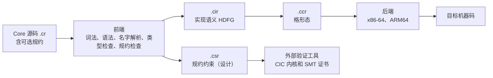

# Core 项目书

Core 是一门以语义中间表示为核心、支持完全形式化验证的编程语言和编译工具链。

## 项目概述

Core 的工具链核心是一个保留类型和语义信息的中间表示。它不把高级结构降为低级指令，而是把源码中的隐式行为、语法糖、类型推导和符号解析展开、归一化并显式化，形成语义中间表示。

在这个基础上，Core 支持完全形式化验证。验证所需的信息分两部分保存：

- 实现语义：由 Core 源码编译生成，保存在 `.cir` 中，描述程序做什么。
- 规约约束：由 `.cr` 文件内联的 `#check`、`#ensure` 和 `spec fn` 生成，保存在 `.csr` 中，描述程序应该满足什么。`.csr` 目前是设计，尚未实现。

外部形式化验证工具可以同时使用 `.cir` 和 `.csr`，直接获得程序的语义模型和证明义务，不需要自己重建语义。

前端在输出 IR 之前校验源码的语法和语义。语法不合法、类型不匹配、名字未解析或规约格式错误的代码会被拒绝。编译工具链还提供多目标代码生成后端、模块化缓存和分发机制。

Core 的目标是说明：一门现代语言可以同时获得较快的编译速度、跨平台能力和完全形式化验证，并且在语言设计上不互相妥协。

完整愿景见 `docs/z-vision.md`。

## 背景

当前编程语言和编译生态存在四个问题。

### 编译时间增长

大型项目重编译耗时很长。主要耗时不在代码生成，而在每次编译都重复处理高级语言特性：头文件展开、泛型实例化、重载决议。这些工作在不同编译单元、不同目标平台，甚至同一项目的多次构建中反复执行。每次编译都在重新处理已经确定的语义。

### 跨平台成本和虚拟机开销

“一次编写，到处运行”依赖运行时虚拟机，带来持续的内存开销和启动延迟。静态交叉编译消除了运行时依赖，但仍要在每个目标平台完整运行前端，从源码开始重新解析。语义信息在逐级翻译中丢失，平台之间的行为差异难以消除。

### 验证和实现分离

程序实现和形式规约使用不同语言书写，由不同工具处理，存放在不同文件中。验证器必须同时解析两者，自行建立程序语义模型，再对照规约完成证明。更换验证工具要重新构建语义模型；修改代码后规约需要手动同步；不同验证工具的证明结果不能互认。

### 执行模型被人为分开

传统语言为不同场景设计不同执行模式：调试模式、发布模式、硬实时模式、教学模式。程序员必须在代码或构建配置中显式选择。模式切换可能引入行为差异和隐蔽错误。学习、开发和教学使用不同环境，使用者需要不断切换。

这四个问题的共同原因是缺少一个同时保存实现语义和形式规约的中间层，以及一个不需要模式概念的通用执行模型。

## 核心设计

### 语义中间表示

Core IR 与一般编译器 IR 的区别是保留语义信息，而不是逐步丢弃。一般编译流水线中，类型、泛型参数和名字在翻译过程中逐级丢失。Core IR 在语法检查后把所有语义信息显式编码为统一格式，供下游按需使用。

实现语义保存在 `.cir` 中，包含：

- 结构化的类型和接口，包括 `struct`、`enum`、`impl` 和 `interface`，保留成员签名、实现关系和方法解析，不降为无类型的数据块。
- 泛型参数，不擦除类型实参。
- 解析后的限定名，包含模块路径。
- 归一化后的语法糖，统一为标准语义节点。
- 以图的形式保存的控制流。

### 规约

形式规约不是注释，也不是独立格式的源文件。规约写在 `.cr` 文件内，使用 `#check`、`#ensure` 和 `spec fn` 等标注。编译时规约并入同一张 HDFG，成为图上的约束标注。规约表达式只允许纯逻辑运算，不能有副作用，不能调用非纯函数。

一个 Core 项目只有一类源文件：`.cr`，里面可以包含实现代码和可选的内联规约。

规约约束的序列化格式是 `.csr`，结构见 `docs/ir-schema/corespecir-schema.md`。每条约束指向图中的对应实体，使用节点索引或符号引用，不另立一份并行 IR。

这样设计有三个结果：

- 规约和实现可以独立修改，不同粒度的规约可以搭配同一份实现语义。
- 验证器不需要解析 Core 源码，也不需要重建语义模型。实现语义已经给出程序行为，规约约束已经给出证明义务。
- 规约格式与验证工具解耦。不同验证工具、不同求解器后端和不同证明策略使用同一份数据，更换工具不需要重写规约。

### 单一执行模型

Core 只有一种执行语义：HDFG（数据流图）。执行后端、验证器和其他使用方都从图中读取语义。

所有代码经语义 IR 翻译后构成一张有向图。节点是操作，边是数据依赖。图保存程序的全部执行语义：

- 纯函数、分支和 `for` 循环形成有向无环图。依赖关系是偏序，没有反馈。
- `loop` 和 `recv` 形成带反馈环的图。区域边界表达迭代和终止。
- `flow`、`go`、`yield` 和 `select` 形成运行时动态图，表达节点创建和并发。

图约束执行语义，不决定物理执行方式。串行、并行和调度策略由部署配置决定。同一张 DAG 可以单核串行执行，也可以多核并行执行，或在无操作系统时使用时间片。

图也是存储语义的基础。值由条目和生成方法表示，存储是语义对象在存在格中的物化。缓存和字节内存都是存在格的映射实例，见 `docs/maintainer/design/materialization-space.md`。

### 三层映射

Core 使用三层映射：

1. 图表达计算，对应关系空间。
2. 格表示计算，对应存在空间，也就是内存模型。
3. 编码实现计算，对应物理编码空间。

跨范式发生在图层。超图灵性属于图，不属于格。格的价值是表达空间不被有限范式限制，不同范式各自寻找自己的格映射。规则见 `docs/academic/cache-semantics.md`，总览见 `docs/maintainer/design/memory-model.md`。

物理约束由部署配置声明，包括内存分配策略、核心数量和操作系统支持。编译器根据配置生成适配目标环境的代码。同一份源码在不同部署配置下的语义行为保持一致。

## 系统架构



### 前端

前端承担主要的语义分析工作。它处理一类源文件 `.cr`，在生成任何 IR 之前完成语义校验。

前端职责：

- 词法和语法解析：覆盖语言的全部语法结构。不符合语法的输入在这里被拒绝，给出错误位置和描述。
- 名字解析和符号绑定：把类型、函数、变量和模块的名字解析为带完整模块路径的限定名，建立全局符号表。未定义引用、重复定义和循环依赖在这里被拒绝。
- 类型检查：检查表达式、赋值、参数传递和返回语句的类型兼容性。不允许隐式窄化转换。
- 规约检查：检查 `#check`、`#ensure` 和 `spec fn` 的语法，检查规约引用的符号是否存在，引用的函数是否为纯函数，表达式是否只使用无副作用的运算。
- 控制流检查：确保每条代码路径都有正确的返回值，变量在使用前已经初始化，模式匹配覆盖所有分支。

语法检查通过后，前端生成 `.cir`。如果源码包含规约，前端还生成 `.csr`。

### 实现语义 `.cir`

`.cir` 是程序执行语义的完整编码，包含：

- 类型定义节点：结构体、枚举、接口和代数数据类型。每个节点记录实现关系、成员签名和可见性。内存布局由后端决定，但布局决策所需的语义信息全部保留。
- 函数和方法的执行结构：区域嵌套和格形态。指令是高级语义原语，包括静态调用、对象分配、字段读写、数组读写、分支和循环。每条指令的源操作数和目标操作数都是完全解析的符号引用。
- 图拓扑元数据：标注每个子图的结构特征，例如 DAG、静态循环或动态生长，供后端选择执行策略。
- 全局符号表：模块间引用全部解析为直接索引，没有重复和歧义。

### 格形态 `.ccr`

`.ccr` 是格形态的落盘格式，保存存在结构，包括条目、版本、存在区间、共存和移除信息。当前版本和字段定义以 `src/compiler/ccr_io.cr` 和 `docs/ir-schema/coreir-schema.md` 为准。

`.ccr` 供后端、验证器和工具使用。它不是另一份实现语义，而是 `.cir` 中存储相关信息的结构化表示。

### 规约约束 `.csr`

`.csr` 保存规约约束，目前是设计，尚未实现。内容包括：

- 前置条件：函数或方法调用前，调用方必须保证成立的条件。可以引用参数和全局状态。
- 后置条件：函数或方法返回后，实现方必须保证成立的条件。可以引用返回值、参数和旧状态。
- 类型不变量：类型的任何合法实例在任意可观测时刻都必须满足的性质。
- 循环不变量：循环每次迭代之前和之后都保持为真的性质。
- 边界条件：证明循环终止所需的递减度量，也就是变体。
- 抽象规约：接口或抽象类对其所有实现方施加的约定。

规约公式可以引用程序的可见实体、特殊逻辑符号（例如 `result` 和 `old(x)`）、纯逻辑函数和条件。

代码生成后端不处理 `.csr`。`.csr` 由形式化验证工具使用。验证工作流见 `docs/maintainer/design/spec-design.md`。已经证明的性质可以回传给优化器，用于证明驱动的优化。

### 后端

后端是翻译器。它只接收实现语义，不处理规约约束，不执行跨过程语义分析。

每个后端维护一张指令映射表，把 `.cir` 中的高级指令映射为目标平台指令序列。后端根据图拓扑元数据选择执行调度策略：DAG 使用串行执行，静态循环使用固定节奏，动态图使用协作式或多核并行。程序员不指定策略。

后端的平台相关职责只有指令选择、寄存器分配和调用约定。当前 x86-64 ELF 后端见 `src/arch/linux/ld/`，直接生成 ELF，不依赖外部 `as` 和 `ld`。

### 部署配置

物理世界的约束不属于程序语义，属于部署目标的属性。这些属性在部署配置文件中声明，例如 `.toml` 文件，不写在代码里。

编译时，编译器读取部署配置并检查兼容性：

- 目标不支持动态分配时，编译器检查所有数据结构的大小是否在编译期可以确定。不能确定就拒绝编译，给出错误和位置。
- 目标支持动态分配时，生成使用目标分配器的代码。
- 声明资源配额时，生成配额检查指令。没有声明就没有限制。

同一份实现语义搭配不同部署配置，可以适配不同目标平台，代码不变。

I/O 和平台接口遵循同一原则：程序语义是流变换。程序是从输入流到输出流的转导器。`read_file`、`write_file`、`print` 和 `println` 是语义接口，`read` 和 `write` 等系统调用是物理实现，由后端按目标隔离。验证意义上，I/O 程序的语义是流变换，规约可以描述输入流性质到输出流性质的变换。随机、哈希和时钟同理：语义接口在语言层，熵源、算法和系统调用在后端。

### 指针安全

Core 的指针安全建立在 HDFG 上，不引入借用检查器、Arena tag 或 RawRef 等独立概念层。编译器从图中推导每个指针的来源（provenance）和偏移，在解引用点自动验证。见 `docs/maintainer/design/pointer-model.md`。

存储语义的本体是存在格。格层回答四个问题：

1. 哪些物化是合法的。
2. 哪些物化可以共存。
3. 哪些物化表示同一个条目和同一个版本。
4. 哪些转换保持语义。

缓存语义是存在格的一类映射实例，不是本体的名字。层定义和七个字段见 `docs/maintainer/design/materialization-space.md`。存储规则见 `docs/academic/cache-semantics.md`。字节内存是经典映射实例，总览见 `docs/maintainer/design/memory-model.md`。

### 验证工具

形式化验证工具是语义 IR 的外部使用方，不属于 Core 的内置组件。

典型工作流程：

1. 验证工具加载 `.cir` 和 `.csr`。
2. 从 `.cir` 构建程序数学模型。
3. 从 `.csr` 提取证明义务。
4. 把证明义务翻译为 SMT 公式或定理证明器脚本。
5. 提交求解并输出结果。

不同验证工具可以使用不同策略和不同求解器后端，但它们使用同一份 IR 数据。更换工具不需要重写规约。

## 执行模型

Core 的执行模型是：程序是 HDFG。图表示全部执行语义，执行方式由部署配置决定，图语义不变。

### DAG：确定性顺序执行

变量绑定、算术运算、函数调用、条件分支和 `for` 循环编译后形成有向无环图。每个节点在全部输入就绪后执行一次，产生输出。

执行器按拓扑序遍历节点。任意时刻只有一个节点在执行，程序状态可以观察和预测。单步调试就是逐步遍历图。

### 带环静态图：固定节奏的循环

代码中出现 `loop` 时，图中引入带环结构，编译为嵌套区域。执行器按迭代周期调度。每个周期内，循环体子区域按拓扑序执行；周期结束回到区域头部，开始下一轮迭代。

循环不变量和变体标注在区域边界，供验证工具证明终止性和循环正确性。终止性依赖由 state edge 显式表达。

### 动态图：并发和自适应

代码使用 `flow`、`go`、`yield` 或 `select` 时，图拓扑可以在运行时变化。新节点由 `go` 动态创建，节点之间的流通过 `yield` 和 `recv` 传递，`select` 在多个输入边之间等待最先到达的值。

多核目标上，节点分配到独立线程并行执行。单核目标上使用协作式调度。同一份语义 IR，编译器根据部署配置选择调度方案。

### 同一份代码的多种部署

```core
fn add(x: int, y: int) -> int:
    return x + y

fn main():
    result := add(3, 4)
    println(result)
```

这段代码可以部署到不同环境：

- 单核嵌入式：生成串行机器码，静态分配，没有运行时依赖。
- 多核服务器：并行执行不相关的计算路径。
- 教学环境：解释器按拓扑序逐步执行，每一步展示变量值。
- 分布式系统：`add` 节点可以远程执行，输入和输出是网络消息。

代码不变，图语义唯一，部署配置不同。

## 总结

Core 要回答的问题是：如果在语言设计之初就把语法检查、语义中间表示和规约约束纳入统一框架，实现语义保存程序行为，规约约束表示证明义务，两者通过符号精确关联，那么编译速度、跨平台能力和形式化验证的要求可以降低到什么程度。

Core 用实际可运行的代码回答这个问题。

## 相关记录

旧版项目书按“两类源文件、两份 IR”叙述的架构和旧图见 `docs/superpowers/implementation/2026-09-16-project-book-old-architecture.md`。
