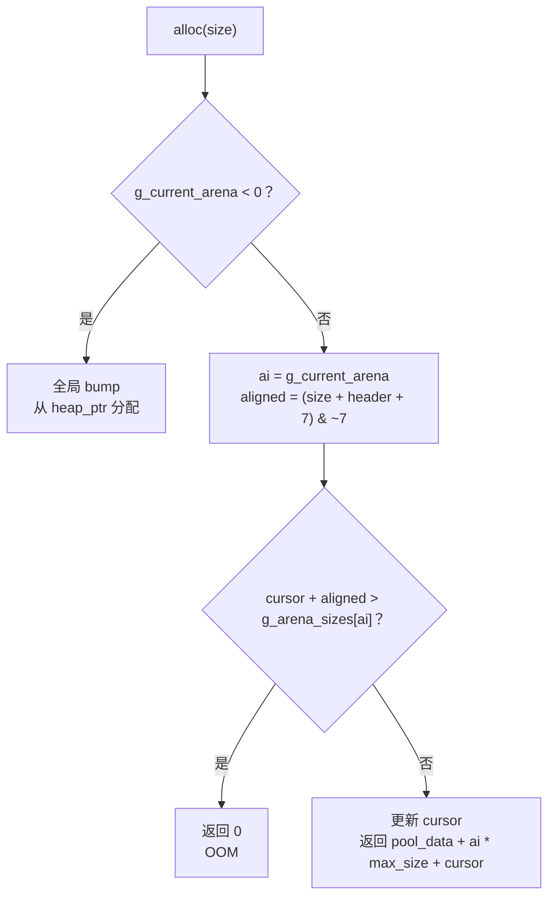

# Arena 内存模型

## 概述

Core 使用 Arena 管理内存。每个子图，包括函数、`loop`、`for`、`unsafe` 和后续的 `flow`、`go`，关联一个独立 Arena。分配从当前 Arena 的 bump 指针取内存，子图退出时整体重置游标。

目标是把原来的全局 bump allocator 升级为多 Arena 池，同时保持用户 API 不变。

设计状态：已实施。BSS 布局、汇编发射细节、组件代码和测试记录见 `docs/superpowers/implementation/2026-07-28-arena-model-audit.md`。

## 原则

- 生命周期管理用 Core 实现，只有 bump 分配路径在底层。
- 用户继续使用 `alloc()`，不学习新的分配 API。
- 编译器自动在子图边界插入 Arena 生命周期指令。
- 没有 Arena 时，回到全局 bump allocator，行为不变。

## 数据布局

BSS 中新增：

```text
g_current_arena       8B   当前 Arena ID，-1 表示没有 Arena
g_arena_pool_data     8B   Arena 池数据区基址
g_arena_free_list     8B   空闲 Arena 链表头，-1 表示空
heap_ptr              8B   全局 bump 指针，作为后备
heap_start                 堆起点
heap_end                   堆终点
```

Arena metadata 数组不作为固定上限的 BSS 静态数组，而是作为 Core 全局变量动态分配：

| 数组 | 含义 |
|---|---|
| `g_arena_cursors` | 当前 bump 偏移，按 8 字节对齐推进 |
| `g_arena_sizes` | 该 Arena 的 chunk 上限 |
| `g_arena_parents` | 创建时的父 Arena，用于嵌套恢复 |

原因是固定 `MAX_ARENAS` 在深层嵌套或大量并发子图时会溢出。metadata 使用可扩容数组。代价是分配热路径多一次间接访存。

## 分配路径



`g_arena_pool_data` 保存 `arena_init` 中 `alloc(pool_size)` 返回的指针。

## 生命周期

```text
子图入口：sg_push(SG_*)，arena_new()，设置 g_current_arena
子图内部：alloc() 从当前 Arena 分配
子图出口：arena_reset(ai)，cursor = 0，g_current_arena = parent，sg_pop()
```

嵌套示例：

```text
fn main():
    // arena_new 后 ai=0，g_current_arena=0
    x := alloc(32)

    loop:
        // arena_new 后 ai=1，parent=0
        y := alloc(64)

    // arena_reset(1) 后 g_current_arena=0，cursor[1]=0
    z := alloc(16)

// arena_reset(0) 后 g_current_arena=-1，cursor[0]=0
```

插入位置：

| 子图 | `arena_new` | `arena_reset` |
|---|---|---|
| `SG_FUNC` | 函数开头 | `IR_RETURN` 发射之前 |
| `SG_LOOP` | `sg_push` 之前 | `sg_pop` 之后 |
| `SG_FOR` | `sg_push` 之前 | `sg_pop` 之后 |
| `SG_UNSAFE` | `sg_push` 之前 | `sg_pop` 之后 |
| `SG_FLOW` | `sg_push` 之前 | `sg_pop` 之后 |
| `SG_GO` | `sg_push` 之前 | `sg_pop` 之后 |

`SG_FLOW` 和 `SG_GO` 是预留插入点。跨 Arena 的结果拷贝在对应原语实现时加入。

每次 `arena_new` 创建一个新的 IR 变量 `_arena_N` 保存 Arena ID。

## 组件

### stdlib

`src/stdlib/arena.cr` 提供：

```text
arena_init(pool_size, arena_size)
arena_new() -> int
arena_reset(ai)
arena_avail(ai) -> int
```

`arena_alloc` 不需要独立函数。现有 `alloc()` 已经能识别 Arena。

### 后端

ELF 后端的分配体有两条路径：

- Arena 激活：加载池基址，取当前游标，对齐大小，检查 OOM，更新游标，返回池地址加偏移。
- 没有 Arena：使用全局 bump。

函数签名不变：`rdi` 是大小，`rax` 是返回指针。调用方不需要知道走哪条路径。

新增两个 IR 指令：

```text
IR_ARENA_NEW=32    arena_new dest, src1 是预估大小
IR_ARENA_RESET=33  arena_reset src1
```

`src1` 是编译器预估的 Arena 大小。后端用它选择 chunk 大小，或者触发链式扩容。

`arena_new` 和 `arena_reset` 作为外部函数发射，通过 call 和重定位跳转。Core stdlib 定义 API，后端提供实现。

### 其他文件

新增 opcode 需要同步：

- `dataflow.cr` 的操作码名字和边连接。
- `ccr_io.cr` 的读写。
- `dyn_arr.cr` 的常量。
- `opt.cr`，确保优化 pass 跳过新 opcode。
- `resolve.cr` 的标签解析。
- `corearch.cr` 的代码路径。

## 大小预计算

编译器在 IR 生成阶段为每个子图累计 `alloc_total`：

1. `sg_push` 时 `alloc_total = 0`。
2. `IR_ALLOC` 的大小是编译期常量时累加。
3. `IR_ALLOC_STRUCT` 按字段数乘 8 累加。
4. `IR_ALLOC_ARRAY` 按元素数乘 8 累加，元素数是常量时有效。
5. 动态大小跳过。
6. `sg_pop` 前得到 `estimated_size`。
7. 如果全是动态大小，结果为 0，使用默认值 64KB。

累计值作为 `IR_ARENA_NEW` 的大小参数。

## 错误处理

- Arena 池分配失败：`arena_init` 返回错误，后续分配走全局 bump。
- Arena 内 OOM：返回 0，与现有 `alloc` 的失败形态一致。
- 没有 Arena：走全局 bump，保持旧行为。
- 嵌套重置：按 `g_arena_parents` 恢复父 Arena。

## 测试

1. 没有 Arena 时，分配行为与旧全局 bump 一致。
2. 单层 Arena：分配、重置、再次分配。
3. 嵌套 Arena：父和子分别分配，子重置后父仍可用。
4. 循环内 Arena：每轮重置，cursor 回到 0。
5. OOM：chunk 上限耗尽时返回 0。
6. 动态大小：使用默认 64KB。
7. 双路径：解释器和 ELF 行为一致。

## 不包含

- 不做垃圾回收。
- 不做跨 Arena 引用检查，由 RegionCheck 负责。
- 不改变 `alloc()` 的用户 API。
- 不做固定上限的 Arena 数量。
- 不做 `flow` 和 `go` 的跨 Arena 拷贝，等对应原语实现。
- 不做并发 Arena 的细粒度锁，当前按单线程模型设计。

## 关联

- 实现细节和测试记录：`docs/superpowers/implementation/2026-07-28-arena-model-audit.md`
- 执行模型：`docs/maintainer/design/execution-model.md`
- 指针模型：`docs/maintainer/design/pointer-model.md`
- 存储语义：`docs/academic/cache-semantics.md`
- 区域 CFG：`docs/superpowers/specs/2026-08-08-region-cfg-design.md`
