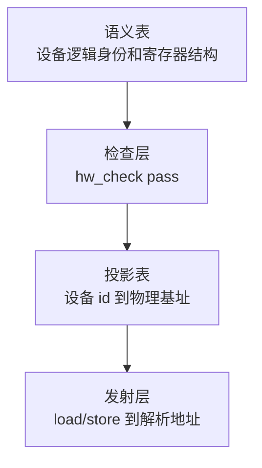
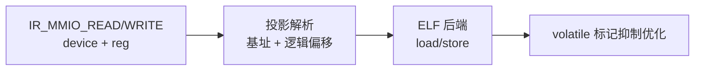

# 硬件映射设计：MMIO 管理

## 概述

内核路线需要汇编级和硬件级能力，MMIO 是第一步。

x86 有标准手册，arm64 SoC 的外设各自定义，内存映射因芯片而异。后端需要一个可以直接编译的具体硬件目标，即参考机。参考机有固定 MMIO 映射，真实硬件通过平台投影接入。

设计状态：已批准。决策记录、检查细节、裸机输出对照和测试阶段见 `docs/superpowers/implementation/2026-08-23-hw-map-audit.md`。

## 结构

硬件映射分三层：



### 语义表

语义表是范式无关的，不含地址。编译期单例 `g_hw_sem`：

```text
Device
    id          逻辑身份，例如 "uart"
    regs[]      寄存器
        name
        offset  设备内逻辑偏移
        width   8、16、32、64
        perm    ro、wo、rw
```

设备由逻辑身份和寄存器结构组成，没有 `base`，也没有绝对地址。语言声明和数据文件编译进同一张表，形式不同，语义相同。

语言内声明：

```core
device UART {
    DATA   : u8 @ 0x00, rw;
    STATUS : u8 @ 0x04, ro;
}
```

数据文件用于真实 SoC，复用 `stdlib/toml.cr`：

```toml
[[device]]
name = "uart"

[[device.reg]]
name = "data"
offset = 0x00
width = 8
perm = "rw"
```

### 投影表

投影表是经典地址绑定，属于后端实现选择：

```text
uart -> 0x3F200000   x64 参考机，编译器内置
uart -> 0xFE201000   树莓派，数据文件导入
uart -> 0x09000000   QEMU virt，数据文件导入
```

同一份语义表配不同投影表，可以把同一程序编译到不同硬件。访问 `UART.DATA` 在语义上是访问逻辑设备内的逻辑寄存器，只有发射时才解析为基址加偏移的 `load` 或 `store`。

## 检查

`hw_check` pass 在 HDFG 上运行，与指针分析、区域检查和 provenance 验证并列，消费 `g_hw_sem`。

语言层的 `UART.DATA` 下降为携带设备和寄存器引用的 IR 节点 `IR_MMIO_READ` 和 `IR_MMIO_WRITE`。

| 检查 | 规则 | 违反示例 |
|---|---|---|
| 存在性 | 设备和寄存器必须在语义表中 | 表里没有 `UART.DATA` |
| 宽度匹配 | 访问宽度等于寄存器声明宽度 | 用 32 位写 u8 寄存器 |
| 读写权限 | ro 不能被写，wo 不能被读 | 写 `UART.STATUS` |
| volatile 顺序 | MMIO 节点不可消除、不可重排、不可合并 | CSE 合并两个 MMIO 读 |

全部检查在编译期完成，运行期没有开销。

外部接口如果使用显式地址，地址能经投影表静态解析回语义寄存器时，四项检查照常执行。解析不到的动态地址按 `unsafe` 外部入口处理，与 `0x` 字面量同角色。

volatile 的实现：IR 节点带 `volatile` 标记。常量折叠、CSE、寄存器分配和调度一律不消除、不重排、不合并 MMIO 读写。每个 MMIO 读都是副作用，读后不用也必须保留。

错误码新增 `E_MMIO_UNKNOWN_REG`、`E_MMIO_WIDTH_MISMATCH`、`E_MMIO_PERM` 和 `E_MMIO_VOLATILE`，具体归属在错误码规范中确定。

## 发射

参考机是 x64 投影表的第一份实例。编译器内置投影表，例如 `src/arch/x86_64/hw_ref.toml`。

第一版外设只有 UART，能打印即可完成最小验证。timer、中断控制器和 GPIO 后续扩展。



裸机输出模式与 Linux 用户态输出的区别：

| | Linux ELF | 裸机模式 `corearch --bare` |
|---|---|---|
| 入口 | `_start` | 同一个 `_start`，无 OS 依赖 |
| 动态链接 | PLT 和 GOT | 无，纯静态 |
| 全局变量寻址 | RIP-relative | 绝对地址，固定加载地址 |
| 加载 | 用户态加载器 | QEMU multiboot 或 flat binary |

复用 `elf.cr`、`instr.cr` 和 `resolve.cr`，只改链接和入口装配。

## 边界

- 外部接口使用显式地址时，不能静态解析的走 `unsafe` 外部入口，不与语义层混淆。
- 检查全部在编译期完成，运行期没有开销。
- 语言层的 `device` 是声明，不是运行时对象。映射表只存在于编译期。

## 测试

1. 语义表构建：`device` 声明解析和 TOML 导入得到同一张表。
2. `hw_check` 四项检查。
3. 投影表和地址解析。
4. x64 参考机投影表和 `IR_MMIO` 发射。
5. `corearch --bare` 裸机输出。
6. 端到端：`.cr` 声明 UART 并打印，经 `--bare` 编译后在 QEMU 运行，断言串口输出。没有 QEMU 环境时跳过。
7. 真实平台投影表数据文件，例如树莓派和 QEMU virt。

回归：现有测试全部保持通过。

## 不做项

- 中断、定时器和 GPIO。参考机第一版只有 UART。
- 页表、MMU 和内存管理。直接使用物理地址，单核。
- 能力模型接入。能力不提升为一等公民，语义仍还原到图上。
- 设备语义注解。留给规约层。

## 关联

- 决策记录和实施细节：`docs/superpowers/implementation/2026-08-23-hw-map-audit.md`
- 硬件接口表：`docs/superpowers/specs/2026-09-05-hardware-interface-table.md`
- 指针模型：`docs/maintainer/design/pointer-model.md`
- 执行标注空间：`docs/maintainer/design/execution-annotation-space.md`
- 地址等于映射：`docs/academic/cache-semantics.md`
