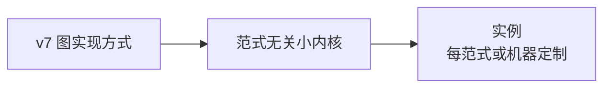

# corearch 重写：范式无关内核和实例

## 概述

corearch 当前与经典计算机绑定过深。目标是把转换编码层拆成两个部分：

内核只处理语义对象、判定和注册契约。实例处理调度重建、编码、帧、ABI、调用序列和实例数据。

设计状态：定稿，内核抽取和组件完备化已实施。执行状态、模块归属细节和挂账见 `docs/superpowers/implementation/2026-09-09-corearch-rewrite-audit.md`。

## 检查

- 输入是 v7 图实现方式，包含边、条目和区域。操作码字典是显式遗留的方法种类引用。
- 重写检查是行为等价加语义正确性方向。逐字节复刻旧发射器的检查已经废止。实例算法可以自由设计，正确性检查是投影和映射正确性。
- 内核判定不读值内容，只操作条目类别。
- 规则封闭，永不新建。对象开放，没有格承诺。共存只要求对称关系。
- 内核不需要理解操作码字典的语义。判定只关心位置、生成方法和存在区间。字典含义由消费侧解释。

## 内核

内核有三个组件。

### 语义对象模型

loader 和解析属于内核。内核把 v7 文件解析为条目、版本、区域和边。

对象包括：

- 条目：位置、生成方法和存在区间。
- 版本和区间。
- 区域嵌套。
- 无生成方法和持久条目，按统一规则处理。

操作码是方法种类引用。内核持有引用，但不解释语义。判定不需要知道值怎么算出来，只需要知道它存在、由谁产生、何时失效。

槽语义投影不在内核。那是执行型实例的翻译事务。

### 判定和分配引擎

引擎处理：

- 共存关系推导，使用 sweep。
- 资源互斥约束，即四条判定：共存互斥、读点无陈旧、移除配对、调用点失效。
- 移除候选和写回规则，持久条目的 home 必须保真。
- 资源域参数化。引擎知道互斥，但不知道资源是寄存器、槽还是量子位。资源域由实例声明。

寄存器分配的判定四条是这个引擎族的第一个已实现成员。内核抽取把语义侧从寄存器分配中拆出来。

### 实例注册契约

实例声明包括：

- 接受什么语义对象流，产出什么。
- 资源域和代数参数。
- 请求分派形态，即实例如何使用判定服务。

corearch 引导时选择实例。注册契约是内核和实例之间唯一的耦合面。新范式实例只需要新注册，不改内核。

内核不包含机器编码知识、调度知识、操作码字典语义和 HIT 表概念。表是实例数据形态，不是内核概念。

## 实例

实例是该范式或机器把语义对象变成自己编码的全部定制内容。没有跨范式共性，不强行建立通用翻译层。

x86 实例包括：

1. 调度重建：把图实现方式变成线性调度，文件序合法化加区域展开。只有执行型实例需要。合法性校验在实例内。
2. lower 和发射：把语义对象和调度变成 x86 编码。
3. 实例算法：帧布局、调用序列、tag 和 2L 编码选择、寄存器物理分配。
4. 实例数据：HIT 表、模板和投影条目。
5. 运行时、ELF、链接和系统调用输出面。

实例向内核注册资源域。内核判定共存、互斥和移除写回。判定结果回传实例，实例完成物理编码。

## 模块归属

| 模块 | 现状职责 | 归属 |
|---|---|---|
| loader、段表、ENT 解析 | 文件到内存对象，ENT 校验 | 内核 |
| ENT 和区间校验、区域根跨度守卫 | 输入契约守卫 | 内核 |
| `compute_live_ranges`、`compute_entries` | 存在区间和版本推导 | 内核 |
| `entries_coexist`、四条判定 | 共存、互斥、移除、失效 | 内核 |
| 寄存器物理分配 | CAG 分配 | x86 实例 |
| 判定自检和注入钩子 | 判定和分配混合 | 判定归内核，分配归实例 |
| 调度重建 | 当前在 loader | x86 实例 |
| 指令发射 | 线性指令到 x86 字节 | x86 实例 |
| 帧、ABI、调用和返回序列 | 实例算法硬编码 | x86 实例 |
| ELF、链接和重定位 | 编码层输出 | x86 实例 |
| HIT 表、模板和 lower | 表驱动编码 | x86 实例 |
| corearch 编排和 flag 分派 | 引导和测试 | 内核引导加实例注册 |
| MW tag 语义和编码 | 语义和编码耦合 | 语义归格层，编码归实例 |
| EDG 和 ENT 消费 | 新增 | 对象归内核，调度消费归实例 |

拆分原则：语义侧归内核，包括存在、区间、共存、移除、写回和互斥，不读值内容，不知道资源名。机器侧归实例，包括物理资源、编码、布局和协议。

## 演进顺序

1. v7 实施：图实现方式落盘，loader 双端修改。这是内核输入契约的前提。
2. 内核抽取：loader 到语义对象模型，判定引擎从寄存器分配中拆出。每步回归通过，只迁移，不改语义。
3. 内核组件完备化：对象模型补完，调度重建移到实例，判定引擎中立化，注册契约完整。已实施。
4. x86 实例化：帧、ABI、调用序列、tag 编码改为实例算法，HIT 表数据化继续推进。检查使用行为等价和投影正确性，不逐字节复刻。
5. 第二范式或非经典实例：验证注册契约。新实例只加注册和算法数据，内核零改动。

v7 和重写可以分开，也可以合并。如果 v7 的 loader 直接产出语义对象，而不是线性流假设，可以避免二次重构。

## 风险

- 内核抽取的最大风险是寄存器分配拆分改变行为。判定四条语义不能动，只迁移代码。每一步都要回归。
- 内核不做调度承诺。如果未来验证器需要与调度无关的图接口，作为对象模型的扩展。
- HIT 表是 x86 实例的数据形态。不承诺其他范式实例也使用表。“换表即换平台”应理解为“换实例即换平台”。
- 内核不解释操作码字典。验证器需要字典语义时，属于独立的字典语义形式化工作。
- 本设计不包含任务分解和 x86 实例内部的具体数据、算法设计。

## 关联

- 执行状态和模块归属记录：`docs/superpowers/implementation/2026-09-09-corearch-rewrite-audit.md`
- 格层边界：`docs/superpowers/specs/2026-09-09-lattice-encoding-boundary-design.md`
- IR 语义设计：`docs/superpowers/specs/2026-09-09-lattice-ir-v7-carrier-design.md`
- IR 格式：`docs/superpowers/specs/2026-09-09-lattice-ir-v7-format.md`
- 内核完备化：`docs/superpowers/specs/2026-09-10-corearch-kernel-completion-design.md`
- 寄存器分配：`docs/maintainer/design/regalloc-cache-mapping.md`
