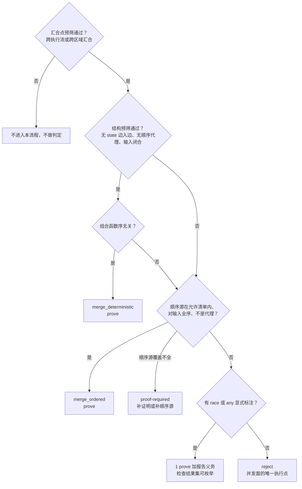

# 汇合语义

## 概述

汇合点是跨执行流或区域汇合的节点。汇合语义回答一个判定问题：

```text
对于汇合点的全部物理到达排列 π 和 π'，
观测 F(c, π) 和 F(c, π') 是否相同？
```

`c` 是输入值多重集，`π` 是输入令牌的物理到达顺序，`obs` 是值、效应和控制去向的观测，`F` 是汇合点的语义函数。

物理到达顺序不是图对象，不能读取，也不能命名。汇合语义只允许语义依赖图上显式存在的顺序源，不允许依赖物理到达顺序。

设计状态：定稿，尚未实现。修订记录、决定编号和现状盘点见 `docs/superpowers/implementation/2026-09-11-merge-semantics-audit.md`。

## 四形态

### merge_deterministic

语义函数与物理到达顺序无关。

```text
F(c, π) = F(c, π')
```

图表示：汇合点带 `deterministic` 标注，或者分析器证明后赋予标注。输入集合必须闭合，所有可能到达的输入边都能在图上枚举。

判定检查：

| # | 检查 | 判定面 |
|---|---|---|
| 1 | 没有 state 边入边，汇合点不在副作用链上 | 图结构 |
| 2 | 从汇合点沿 def-use 和 state 链可达的节点中，不存在读取到达位置、时刻或顺序的量 | 图结构 |
| 3 | 组合函数在输入多重集上良定义，满足交换律和结合律，有重复到达路径时还满足幂等律 | 类型引擎 |

第 2 条检查依赖一个结构事实：物理到达顺序 π 不是图对象，图上没有“到达序号”这种输入端口。依赖物理顺序只能通过代理量实现，例如时钟、自旋计数、原子序号、线程 id、就绪队列位置，或者以“第几个到达”为条件的分支。代理量是普通图节点，可以扫描。

第 1 条检查只在 state 链覆盖全部可观测效应时可靠。当前实现已经满足：入链检查使用单一依据 `purity_op_effect`，store 家族、外部调用、spawn、yield、hotpatch、间接调用、原始指针写和 await 都进入 state 链；`fi_ispure` 使用真实纯度计算，未证纯的可解析调用也进入链。保守方向是宁可多判 `ordered`，不可漏判 `deterministic`。

剩余限制：

- state 链每个函数重置，跨函数不连接。
- 覆盖率上界是 `purity_op_effect` 的 opcode 清单。新增 opcode 必须同步这个单一依据。
- 惰性判定生成期仍读乐观默认值，不在本检查范围内。

归入档位：第 1、2 条自动判定，零成本；第 3 条自动证不出时归入 proof-required，由用户提供证明或约定。

观测可见性：完全确定。可以出现在“已证明”列表中，不能出现在不确定列表中。

### merge_ordered

物理到达顺序被一个显式顺序源投影。

```text
如果 σ(π) = σ(π')，则 F(c, π) = F(c, π')
```

`σ` 是图上的顺序源，来自 state 边链或区域迭代序。

图表示：汇合点带 `ordered(src)` 标注，`src` 是顺序源类型，并且图上存在从 `src` 到每条入边的定序见证。

判定检查：

1. 每条入数据边都能溯源到一个顺序源。
2. 顺序源在输入集合上是全序，任意两条输入可以比较，不冲突，不并列。
3. 顺序源是图上显式对象，不是物理到达顺序的代理。

并列时不能无提示地 tie-break，否则物理顺序会从后门进入语义。

否定例：

| 候选 | 为什么不是顺序源 |
|---|---|
| 物理时间戳或 sleep 时长 | 读取物理时间，是物理顺序的代理 |
| 线程 id 或就绪队列位置 | 调度器内部状态，是物理顺序的代理 |
| 声明式优先级 | 只决定同时就绪时谁赢，而“同时就绪”由物理决定，仍属于 `race` |
| 通道 FIFO 序 | 同一通道上的 send 序是图上的，跨通道不是。只有每条输入边各自有 state 链时才能作为顺序源 |

归入档位：顺序源全序且函数被唯一确定时 prove；顺序源存在但覆盖不全时 proof-required。

观测可见性：确定。可以出现在“已证明（顺序源：state 边或区域序）”列表中。

### race

汇合点的观测集合确定，但具体元素由实现选择。

```text
Obs(M) = { obs(F(c, π)) : π ∈ Π }
```

`Obs(M)` 必须是确定的有限集，元素可以枚举，或者显式声明不可枚举。不可枚举在高安全模式下拒绝。

图表示：汇合点带 `race(k)` 标注，`k` 是胜者数量，缺省为 1。没有标注的竞争是隐式竞争，归入 reject。

归入档位：1 prove 加报告义务。证明内容是“该汇合点是此处唯一的不确定源”，证明范围只覆盖汇合点本身，不覆盖观测点。报告必须标注这个未覆盖范围。

观测可见性：报告必须列出汇合点 id、输入边集、`k`、结果集基数上界或不可枚举标记、provenance 链，以及证明范围。

胜者身份可以作为显式出参，即 witness。witness 是图上的一条显式值边，不是物理顺序的代理，登记为 `EXPLICIT` 不确定源并附带报告义务。

race 不豁免确定性。它承诺的是集合确定，不是“此处随便”。

### select_any

汇合点的观测对输入来源身份不敏感。

```text
F 只依赖“有输入”，不依赖“从哪条边来”
```

判定有两条路径：

| 路径 | 条件 | 结果 |
|---|---|---|
| 等价升级 | 各分支体的值、效应和控制去向等价 | 升级为 `merge_deterministic`，prove，零成本 |
| 默认 | 无法证明等价 | 与 `race` 相同，显式不确定加报告义务 |

等价升级依赖效应等价判定。当前类型引擎能判定类型项，还没有效应等价判定器。因此等价升级是目标形态，默认为第二条路径。

归入档位：等价升级时 prove；默认时 1 prove 加报告义务，证明范围局部。

观测可见性：等价升级不进入报告；默认进入报告，并附“来源身份不敏感”说明。

## 判定顺序

给定一个汇合点，按以下顺序判定，先到先得：



证明优先于声明。如果第 2 步已经证明序无关，即使节点带 `race` 或 `any` 标注，报告按实际分类为确定，标注降级为冗余声明诊断。报告必须显示程序实际的不确定性，不是用户声明的不确定性。否则 `race` 会成为隐藏本来可证程序的通道。

## 物理不能推出语义

定义：如果同一张图、同一输入在两次执行中的观测不同，而图上没有任何节点声明 `race` 或 `any`，且差异可以归因于发射层、调度器或求值顺序，就称为引入不确定性。

被限制的不是调度器的自由度，而是自由度进入观测。调度器可以任意选择，只要选择不影响观测。

三个检查面：

| 面 | 检查内容 | 合法和非法例子 |
|---|---|---|
| 发射层 | IR 到机器码或表条目的 lowering 不得引入顺序依赖 | 合法：确定性汇合的 n 输入加法按寄存器顺序发射，加法可结合。非法：把非结合算子降低为顺序敏感实现，或把“先到先累加、超界截断”当作确定性汇合 |
| 调度器 | 就绪队列顺序不得成为语义输入 | 选择函数只能读图上声明的顺序源。禁止用时间片计数或线程 id 做 tie-break 并影响观测 |
| 求值顺序 | pass 重排、内联、CSE 和寄存器分配不得改变汇合点的输入集合或引入顺序依赖 | LICM 和惰性下沉不得把带 state 边的节点跨过汇合点。CSE 合并两个 race 点会改变结果集基数，必须检查 |

每个编译器变换都必须保持观测。部署配置切换调度策略后，观测必须不变，除非是已声明点。

## select 的迁移

当前仓库没有 `select` 关键字，没有 `Select` 产生式，没有汇合 IR，也没有测试用例。`select` 语义只存在于文档中。因此迁移没有已编译的用户代码要兼容，兼容对象是文档、示例和未来的语法设计。

迁移目标：`select` 表示多输入汇合加内容相关分派。图级默认是未标注。语义不再是“最早到达”。“最早”只是 `race(1)` 的一种实现选择，不是语义承诺。

| 情形 | 判定形态 | 档位 |
|---|---|---|
| 分支体观测等价，可证明 | `select_any` 升级为 `deterministic` | prove |
| 到达顺序由 state 边或区域序固定 | `merge_ordered` | prove |
| 分支体不等价，没有顺序源，有显式标注 | `race(1)`，必要时加 `any` | 1 prove 加报告义务 |
| 分支体不等价，没有顺序源，没有标注 | reject；窗口内 warning 加自动 `race(1)` | reject 或窗口内警告 |

兼容窗口：

| 阶段 | 行为 | 诊断 |
|---|---|---|
| W0 | 文档语义是最早到达，没有实现 | 无 |
| W1 | 未标注的 `select` 接受，自动按 `race(1)` 处理 | warning：隐式竞争，请显式声明 `race(k)` 或 `any`，或提供确定性证明；报告登记 |
| W2 | 未标注的 `select` 拒绝 | error，指向三种修复通道 |

窗口从首个 `select` 实现开始，长度为一个发布周期。严格模式和 CI 在窗口内也不放宽。窗口内容是“接受并标注”，不是“保留旧语义”。旧语义在任何阶段都不再是语义，只降格为 `race(1)` 的一种实现选择。

保留 `select` 拼写，重新确定语义。理由：

1. 当前没有实现，没有迁移成本。
2. 保留拼写使既有文档和示例保持可读，改动面收敛到语义段。
3. 四形态不进入关键字表。形态是图标注，源码拼写由标注通道保存。`select` 是汇合语法，属于图构造；`race`、`any` 和 `deterministic` 是图上标注，属于属性面。

不采用把 `select` 改成库函数或宏的方案。汇合会改变图拓扑，库函数无法在类型层表达入边集合。

## 与既有机制的接口

### state 边

state 边有两个角色：

1. 作为 `merge_ordered` 的第一顺序源，副作用链的链序是图上全序。
2. 作为 `merge_deterministic` 的排除面，有 state 边入边就不是确定性候选。

这两个方向相反。`ordered` 用顺序确定结果，`deterministic` 用“不依赖顺序”绕过顺序。实现时不能把“有 state 边”直接判成确定或不确定，必须按判定顺序处理。

`select` 不是顺序源。汇合点的定序只能来自 state 边链或区域迭代序。`select` 的胜出边是 `race` 的结果，不能回填为顺序源用于 prove，否则会把“最早到达”从后门固化为证明前提。

### 区域

区域迭代序是第二顺序源。`SG_LOOP` 和 `SG_FOR` 的迭代顺序是图上全序。

`SG_FLOW` 当前没有产生点，只是预留。跨执行流汇合的容器语义要等 `SG_FLOW` 实现后启用。四形态定义不依赖区域种类。

`SG_IF` 覆盖区间是条件和汇合点之间。分支内取值和分支外节点在汇合后同时出现，不是两个执行流。汇合点检查不能把这种情况当成跨执行流汇合。

跨区域汇合是典型候选。判定使用节点区域归属和 parent 链做常数时间查询。

### 自动并发

自动并行只能移动已经证明的 `merge_deterministic`，或者满足保序条件的 `merge_ordered`。移动本身是一次 lowering，必须通过发射层、调度器和求值顺序三个检查面。

可判定性给出“能并行”，确定性判定给出“并行后语义不变”。两个条件都通过才能移动。

`merge_ordered` 的保序并行可以纳入移动集合，前提是 lowering 能证明 state 边序等于观测序。证不出就不移动。

成本模型和调度开销归 S-C，本设计不涉及。

### 与状态版本族的分界

隐式竞争的外部不可见面由状态版本族处理。分界按变更源身份：

- 变更源是图节点，归本族。
- 变更源是边界条目或未知 extern，归状态版本族。
- 交集场景先走状态版本族的保守面，本族不重复报告，只产生一条诊断。

## 义务与报告

| 形态 | 义务 |
|---|---|
| `merge_deterministic` | prove，零成本 |
| `merge_ordered` | prove；覆盖不全时 proof-required |
| `race` | 1 prove 加报告义务，证明范围局部 |
| `select_any` 等价升级 | prove，零成本 |
| `select_any` 默认 | 1 prove 加报告义务，证明范围局部 |
| 隐式竞争 | reject |

报告必须包含：

- 形态。
- 汇合点 id。
- 输入边集。
- 顺序源，若存在。
- `race` 的 `k` 和结果集基数上界。
- witness 引用，若暴露。
- 分类：已证明、已声明、冗余声明、拒绝。

冗余声明是标了 `race` 但已经证明确定的项，单独列出。

## 检查

1. 正向：确定性汇合通过，产物与没有标注的版本一致。
2. 负向：隐式竞争拒绝，诊断指出汇合点和输入边。
3. 顺序：有 state 边顺序源的汇合通过，缺顺序源时归 proof-required。
4. race：显式标注通过，报告列出结果集和局部证明范围。
5. 预筛：普通二元节点和 `SG_IF` 分支交叉不进入本流程，不能被拒绝。
6. 降级：lowering 引入顺序依赖时拒绝编译。
7. 分界：同一场景只产生一条诊断。
8. 零回归：没有汇合构造的既有语料产物逐字节相同。

## 不承诺

1. 错误的 specification。确定性证明只说明当前图上的汇合与物理顺序无关，不说明程序需求正确。
2. 恶意或失陷的外部实体。外部输入和调度环境可以产生物理不确定性。本设计只要求它不能在没有声明的情况下进入语义，不能消除物理不确定性。
3. 需求本身允许危险行为。`race` 和 `select_any` 是显式请求的不确定，本设计不阻止，只要求声明、证明和报告。
4. 效应等价判定。`select_any` 的等价升级依赖效应等价判定器，当前没有。默认路径是显式不确定加报告。
5. 所有汇合都能判定。无法判定时归 proof-required 或 reject，不能当作确定。

## 不做项

- 不把物理到达顺序作为语义。
- 不新增第五档义务。
- 不把 `select` 保留为“最早到达”语义。
- 不把 `race` 当作“此处随便”。
- 不做自动并行的成本模型。
- 不在本设计定义外部不可见面的竞争，归状态版本族。
- 不修改图本体，只使用标注和既有区域、state 边结构。

## 开放问题

| # | 问题 | 状态 |
|---|---|---|
| 1 | 效应等价判定器的实现 | 未实现，`select_any` 等价升级暂不可用 |
| 2 | `SG_FLOW` 的实现和跨执行流汇合容器 | 预留，未产生 |
| 3 | `race` 结果集不可枚举时的处理 | 高安全模式拒绝，默认模式登记 |
| 4 | 顺序源允许清单的扩展 | 当前只有 state 链和区域序 |
| 5 | 自动并行移动的验收方式 | 需要 lowering 证明和成本模型 |
| 6 | `select` 语法和文档同步 | 实施批执行 |

## 关联

- 修订记录和自检：`docs/superpowers/implementation/2026-09-11-merge-semantics-audit.md`
- 共享契约：`docs/superpowers/specs/2026-09-11-semantic-safety-roadmap.md`
- 属性轴和义务：`docs/superpowers/specs/2026-09-11-semantic-safety-obligations-design.md`
- 执行模型：`docs/maintainer/design/execution-model.md`
- 状态版本：`docs/superpowers/specs/2026-09-11-policy-state-version-toctou-design.md`
- 区域 CFG：`docs/superpowers/specs/2026-08-08-region-cfg-design.md`
