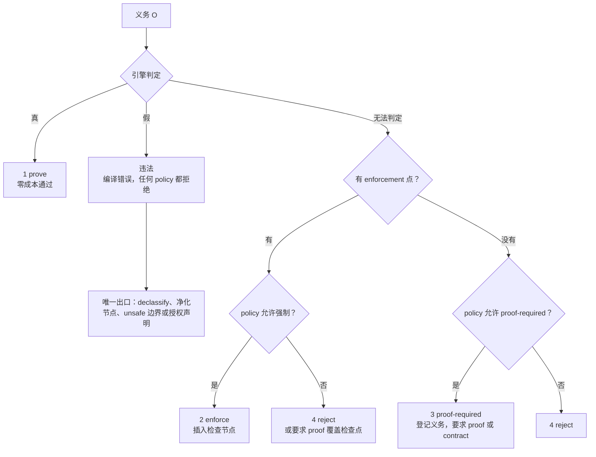

# 安全属性轴与义务分级

## 概述

安全属性轴是图对象和边上的开放标注维度。义务分级把由属性轴导出的判定要求分成四档：静态证明、运行时强制、要求证明、拒绝编译。

属性轴是数据，不是语言 primitive。新增安全模型只增加 policy 数据，不改 Graph 本体，不加关键字。判定统一走类型引擎。

## 属性轴

### 形式约定

1. 值域不固定。任何轴的值域、偏序和格代数都是 policy 数据。每个轴必须有三件结构：值域、偏序、传播规则。
2. 轴是开放标注，不提升为语言 primitive。只有义务可以拒绝编译。
3. 传播单调。派生不提高信任、不降低机密性、不提高完整性、不延长生命周期。唯一例外是显式净化或降密节点。
4. 降低标签的唯一通道是 `declassify` 或同构的净化节点。降密节点本身带授权义务。

### 基础七轴

| 轴 | 语义 | 载面 | 来源 |
|---|---|---|---|
| `trust` | 值是否由受控方产生，信任只降不升 | 节点标注加值流传播 | 领域库声明不可信来源，自动推导传播 |
| `secrecy` | 值是否允许流向公开观察面 | 节点标注加值流传播，输出点标注公开面 | 领域库声明机密来源，自动推导传播 |
| `integrity` | 值是否可能被非授权方改写 | 节点标注加值流传播 | 领域库声明外部输入，自动推导传播 |
| `authority` | 什么操作被允许，授权归治理层 | 治理层的关系标注，不是值流边 | 声明式进图，领域库或治理声明 |
| `lifetime` | 值和条目的存在区间 | 区域加条目版本 | 自动推导，领域库声明边界 |
| `state-version` | 值观测的是哪个版本 | 条目和 IR 变量版本 | 自动推导，版本编号由图构造生成 |
| `effect` | 节点或值是否产生副作用 | 节点标注加 state edge | 自动推导，领域库声明 FFI 效应 |

`trust` 能判定的是不可信性在程序内的传播。来源本身的真实性不能由语言判定，只能通过可复现构建、签名和 provenance 缩小范围。

`authority` 的载面与其余六轴不同。它不是值属性，而是治理层的关系标注。`unsafe` 和 `alloc_at` 是例外入口的授权点。

`lifetime`、`state-version` 和 `effect` 的表示已经在图上运行：区域、条目版本和 state edge。`trust` 的传播与 provenance 同边。`authority` 使用治理层的既有关系。S-A 的工作是把这些标注维度显式化，并给出判定和归入档位的流程。

### determinism 族

`determinism` 不是单一轴，而是七个独立轴。每个轴独立标注、独立归入档位，不能合并成一个 `determinism` 维度。

| 轴 | 语义 | 载面 |
|---|---|---|
| `D_value` | 值和结果确定性 | 节点和纯值流 |
| `D_effect` | 副作用顺序确定性 | 节点和 state edge |
| `D_memory` | 内存行为和生命周期确定性 | 区域和条目 |
| `D_timing` | 时间和最坏执行时间 | 节点或区域的上界标注 |
| `D_resource` | 资源上界确定性 | 节点或区域的静态上界 |
| `D_external` | 外部输入依赖确定性 | 边界节点 |
| `D_mapping` | 跨机器语义确定性 | 语义层性质，不是图对象标注 |

`D_timing` 使用三值：`PROVED` 表示机器无关上界，`MODELED` 表示机器相关成本模型估计，`UNKNOWN` 表示无法判定。`MODELED` 不是证明，诊断和报告中必须与 `PROVED` 区分。

`D_mapping` 是唯一不是标注型的轴，只登记，不建立机制。

### 轴间耦合

| 耦合 | 内容 | 归属 |
|---|---|---|
| `trust` 和 `integrity` | 来源可信不等于不可篡改 | 注入和授权 |
| `secrecy` 和 `authority` | 降密需要授权 | 信息流和授权 |
| `state-version` 和 `integrity` | 版本是完整性的时间证据，检查和使用必须同版本 | 状态版本 |
| `effect` 和 `authority` | 有副作用的操作需要证明和授权 | 授权 |
| `lifetime` 和 `effect` | 副作用链的有效范围等于区域边界 | 路径限制 |

## 义务四档

义务是由属性轴导出的、必须在编译或验证期处理的要求。

```text
义务 O = (轴 a, 源标注 S, 汇要求 R, 落档策略 policy)
判定输入 = 图上从 S 到 R 的值可达性或形状包含性
义务状态 = open 变为 proved、enforced、proof-provided 或 rejected
```

不存在从 `open` 直接到 `passed` 的状态。

### 决策树



三个关键区分：

1. 违法和 4 reject 不同。违法是已经判定不合法，任何档位都拒绝。4 是无法处置，是“不知道”的结果。
2. 引擎返回三态：真、假、无法判定。无法判定包括预算耗尽、桥接失败和名称不展开。证不出不是异常，是正常输入。
3. 档位选择是 policy 数据。同一条义务在不同 policy 下可以落到不同档。

### 默认强度

| 面 | 本地开发默认 | 严格模式或 CI |
|---|---|---|
| 档 3 | 登记并继续编译，状态是 open，不是通过 | 拒绝编译 |
| 档 2 | 默认启用，能强制就强制 | 关闭强制通道，归入 4 |
| 未声明的边界条目 | 取 `unknown`，不拒绝编译，登记并写入报告 | 拒绝编译 |
| CI | 不阻塞 | 断言义务清单为空 |
| `select` 迁移 | 窗口 W1 内宽松并给具名诊断 | 窗口后强制标注 |

各族只能引用这张表，不能自己发明默认值。族级例外由 S-A 给出。

### 与 where 三档的关系

| where 三档 | 四档落位 |
|---|---|
| 常量档，编译期常量 | 真到 1，假到违法 |
| 符号档，符号项 | 真到 1，无法判定到 3，假到违法 |
| 动态档，运行期值 | 2 enforce，严格模式到 4 |
| 三档没有对应的不可强制义务 | 3 或 4 |

`where` 语法目前没有实现。四档流程可以先于 `where` 语法实施。

### 成本和可判定性

| 档 | 成本 | 可判定性 | 失败语义 |
|---|---|---|---|
| 1 prove | 零新增字节 | 引擎在预算内返回真 | 不适用 |
| 2 enforce | 检查节点字节，例如比较、跳转和陷阱指令 | 不可判定，但检查语义可以定义 | 默认硬陷阱中止，库可以声明其他行为 |
| 3 proof-required | 零运行期成本，成本在 proof 或 contract 的撰写和验证 | 不可判定且不可强制 | 诊断加清单条目，严格模式拒绝 |
| 4 reject | 不适用 | policy 的后果，不是判定结果 | 编译错误，给出路建议 |

引擎预算耗尽归入无法判定，再按决策树落到 2、3 或 4，绝不能当作通过。诊断必须区分预算耗尽和判定为假。

## policy 接口

### 条目

| 字段 | 内容 |
|---|---|
| `name` 和 `ns` | 策略名和命名空间，同名不能重复注册 |
| 涉及轴 | 基础七轴或 determinism 族的一个或组合 |
| 源声明集 | 哪些节点是来源 |
| 汇声明集 | 哪些汇是危险落入点，区分语法位和值位 |
| 流规则 | 非法边的形状 |
| 归入档位规则 | 本策略对 2、3、4 的取舍，即 `allow_enforce`、`require_proof`、`strict` |
| declassify 通道 | 本策略认可的降密或净化节点 |
| 放行和声明条目 | 所有绕过义务的通道，必须落清单 |
| 档位粒度 | 全局默认加每策略覆盖 |
| 诊断码 | 错误码和消息模板 |

放行和声明条目的字段：

```text
kind{declassify | grant | deny | mint | stability}
主体或身份
目标或范围
理由
派生源
义务引用
```

`declassify` 是显式降密或净化。`grant` 和 `deny` 是对已有对象或权限的授予和拒绝。`mint` 是能力创建点，例如根声明或 `alloc_at`。`stability` 是治理层的稳定性声明。

条目默认是图上显式节点，可以枚举和审计。偏离节点形态时必须显式豁免并给出理由，同时补齐审计字段。

### 挂法

策略表与类型接口注册表并列，不复用接口表。理由有三条：

1. 策略不是类型接口。混表会把安全策略做成类型特判。
2. 接口表的布局有历史遗留，策略表另立，两者互不阻塞。
3. 新增策略只是增加数据行。

查询 API 使用 `policy_*` 风格，判定统一走引擎。现有的插件标签表已经是开放表的原型，策略表是它的语义提升。

### 判定

```text
A_a(v)：轴 a 的取值 v 到类型项，policy 数据
Shape(sink)：汇的形状项，policy 数据，语法位和值位在这里编码
判定：ty_sub(τ_value ⊓ A_a(v), Shape(sink))
```

引擎返回三态，直接进入决策树。判定失败时用反例值给出具体示例。策略侧只提供数据，不新增判定算子、规范化规则或缓存语义。

### 健全性约定

如果 `A_a` 用否定形式展开，例如 `untrusted` 映射为 `¬Trusted`，左侧求交可能变成 `⊥`，而 `⊥` 包含于任意形状，判定会对所有汇放行。这是结构性风险，必须用五条约定堵住：

1. 左侧只加约束。`A_a(v)` 必须是纯合取式的正编码，禁止用否定形式编码属性。
2. 要求写在右侧。汇需要什么写在 `Shape` 一侧，不写在左侧值项上。
3. `⊥` 不算真。判定入口检查 `ty_inhabited(τ_value ⊓ A_a(v))`，左侧不可满足时不得判为通过，归入无法判定，按 policy 处置。
4. 正反测试。否定形式展开不得放行；左侧塌为 `⊥` 时按失败处理；非退化正例必须通过；右项为 `⊤` 的策略在装载期拒绝。
5. 非退化。`Shape` 在语法位和裸语法位不得为 `⊤`；每个轴取值必须有非退化正例，例如 `Trusted ⊓ string ≠ ⊥`；未定义原子取 `unknown`，不能取真。

### 持久化

policy、标签、降密记录、义务清单、决策记录和成本事实各立段，随类型接口的格式阶段进入 `.ccr`。段名和布局在实施阶段确定，段 tag 空间可以扩展。

在格式就位前，policy 数据随编译输入进入前端。这是过渡状态，不是目标形态。

### 语法

轴标注使用既有的插件标签通道。领域库注册轴标签，`data` 保存轴 id 和轴值。语言本体不加语法、不加关键字。

参数级档位约束放在 policy 数据表中，键是 `(ns, policy_name, fn, slot)`，不新增声明语法。

### 装载期校验

- 形状项和根声明只在受控命名空间内有效，装载期校验。谁有权声明形状项或根，记入 policy 面，对装载器可见。
- `Shape` 在语法位为 `⊤` 时拒绝装载，并给具名诊断。
- 放行和声明条目的六个字段必须齐备。缺少派生源或义务引用时拒绝装载。
- 装载校验是数据校验，不是新的判定体系。

## enforcement

运行时强制档已经有先例：边界检查节点 `IR_BOUNDS_CHECK` 的语义是比较失败则执行 `ud2`，发射走插件钩子，解释器和 ELF 两条路径都已实现。

强制档不需要新机制，它就是插件钩子、图侧检查节点和硬陷阱的推广。

插入位置在 pass 层，与指针验证和区域检查同级。检查节点是图上节点，不新增语义。

发射条件：

- 引擎证明恒安全，不发射，零字节。
- 引擎证明恒违法，编译期拒绝。
- 无法判定，保留检查，并把证明失败的原因写入节点，兼作验证证据。

失败语义：

| 语义 | 内容 | 适用 |
|---|---|---|
| abort | 硬陷阱，默认 | 安全类检查点 |
| degrade | 净化降级后继续 | 库声明 |
| report | 报告并返回错误值或错误码 | 库声明 |

默认是 abort。中止优于未定义行为。`degrade` 必须由 policy 显式声明，否则等于无提示放行。

强制档实现后，检查语义必须在解释器和 ELF 两条路径上一致。

## 诊断

义务状态机：

```text
open --证明为真--> proved
open --强制------> enforced
open --提供证明--> proof-provided
open --严格未满足-> rejected
open -------------> passed 不存在
```

证不出时必须归入 2、3 或 4，绝不能当作通过。档 3 的“登记”状态仍然是 open，是待办，不是已通过。

三个面必须同时可见：

| 面 | 内容 |
|---|---|
| 诊断面 | 错误码和警告。必须区分不可判定与不合法、未处置与通过、预算耗尽与判定为假 |
| 清单面 | 义务清单：轴、源、汇、归入档位、状态、图到源码位置。严格模式下 CI 断言清单为空 |
| 产物面 | 义务清单是图数据的视图，验证工具直接使用，不必重跑前端 |

“不会无提示”的检查：

- 留一条未处置义务，编译输出必须包含具名诊断和清单条目。
- 同一条义务在严格模式下必须拒绝编译。
- 净化后必须通过，清单状态为 proved，没有诊断。
- 任何“义务存在但输出无诊断且清单无条目”的场景都是违约。

档 4 的拒绝必须给出路：补 proof 或 contract、加 declassify、使用显式例外入口。例外入口要记入清单。

## 最小切片

第一版选 `trust` 轴。原因：

- 有现成的不可信来源：`read_file`、`get_env` 和 argv。
- 有现成的危险汇：`system(cmd)` 是命令注入点。
- 有净化先例。
- 不需要新 opcode，规则是静态的。

策略只有一条：不可信数据不能到达 `system` 的 `cmd` 参数，也就是语法位。这是注入设计的前身，但本切片只做流规则和档位流程，不做 SQL 或 HTML 领域库。

正向对照是经过净化节点后通过。负向对照是不可信输入直达 `system`。

切片分三项：

| 任务 | 内容 |
|---|---|
| 1 轴标注和传播 | 库注册来源标签，沿 def-use 边传播。没有来源标注时零产物变化 |
| 2 义务、判定和归入档位 | 构造义务，调用 `ty_sub`，按决策树归入档位，违法时给诊断和反例 |
| 3 清单、诊断和对照 | 输出义务清单，分配错误码，运行全部正负向对照 |

切片不做：

- 不新增 opcode。
- 不做运行时强制实施，只留接口位。
- 不做 `.ccr` 的 POLICY 段，清单先放编译输出。
- 不依赖 `where` 语法。
- 不依赖类型接口的后续接线，只使用已经实现的引擎 API。
- 不判定隐式流，档 3 只以登记形态出现。

验收：

1. 净化路径编译通过，产物与没有轴标注的版本逐字节相同。
2. 不可信输入直达汇时编译拒绝，诊断包含轴名、源位置和汇位置。
3. 无法判定的义务在清单中有条目。
4. 不使用该轴的既有语料零回归。
5. 切片不包含运行期检查，双路径检查留给第二片。

候选第二片是 `determinism` 族的隐式竞争拒绝。判定输入是图上已有事实：共享条目、两个并发区域、没有 state edge 顺序源、没有显式请求标注。结果是拒绝。显式 `race` 和 `select_any` 的正向对照依赖汇合语义设计，未就位前只做负向对照。

## 检查

1. 术语一致：本文与后续安全规格使用同一套轴、义务和四档定义，没有重新定义。
2. 流程完备：每条义务都落到一个档位，没有 open 悬挂，没有 passed 旁路。
3. 判定统一：引擎是唯一判定入口，策略侧没有新增判定算子、规范化或缓存。
4. 不会无提示：正负向对照和严格模式对照全部通过。
5. 零成本：prove 档与没有轴标注的程序逐字节相同。
6. 可扩展：新增一条策略只需要加数据，不加关键字，不改 Graph 本体，不改判定器。
7. 诊断准确：无法判定、预算耗尽、`MODELED` 和判定为假、`PROVED` 在措辞和错误码上可以区分。
8. 非退化：否定形式展开不放行，左侧塌为 `⊥` 按失败处理，`Shape` 为 `⊤` 拒装，每个轴有非退化正例，未定义原子取 `unknown`。

## 不承诺

| 类别 | 本设计的位置 |
|---|---|
| 错误的 specification | 只能证明程序忠实执行了 policy，不能证明 policy 本身正确。漏声明汇、错形状来源和错误映射不在义务分级结构内 |
| 恶意或失陷的外部实体 | `trust` 轴提供声明和检查通道，但不能证明被声明为可信的组件真的可信。供应链、编译机、密钥和硬件后门不能用语言语义证明 |
| 需求本身允许危险行为 | shell、浏览器、内核和 JIT 必须执行外来代码。目标是证明隔离边界，不是禁止能力。`declassify` 和 `unsafe` 是显式授权点 |

不承诺自动证明所有程序安全。判定引擎是三态加预算守卫，`unknown` 是设计内的正常结果。

## 不做项

- 不改 Graph 本体：零新 opcode、零新关键字、零新图结构。
- 不建第二判定体系。
- 不做自动证明搜索。
- 不把安全策略做成类型特判。
- 不把无法判定的义务当作通过。

## 关联

- 修订记录和评审：`docs/superpowers/implementation/2026-09-11-semantic-safety-obligations-audit.md`
- 语义安全共享契约：`docs/superpowers/specs/2026-09-11-semantic-safety-roadmap.md`
- 类型接口判定引擎：`docs/superpowers/specs/2026-09-10-type-interface-unification-design.md`
- 信息流：`docs/superpowers/specs/2026-09-11-policy-information-flow-design.md`
- 授权：`docs/superpowers/specs/2026-09-11-policy-authorization-design.md`
- 路径限制：`docs/superpowers/specs/2026-09-11-policy-resource-confinement-design.md`
- 状态版本：`docs/superpowers/specs/2026-09-11-policy-state-version-toctou-design.md`
